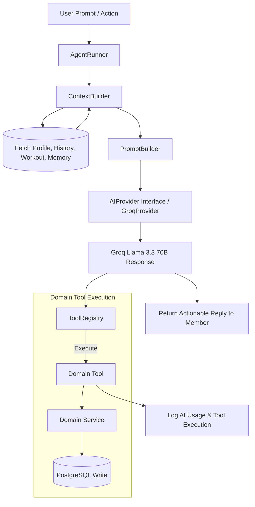

# STRIVA V2 — TRINETRA AI ENGINE SPECIFICATION

## 1. PRODUCT IDENTITY & AI ARCHITECTURE

- **Branded Identity**: **TRINETRA**
- **Definition**: TRINETRA is STRIVA's intelligent health guidance layer. It understands the user's fitness context across training, nutrition, recovery, progress, goals, and history, then turns that understanding into clear actions.
- **System Architecture**:

---

## 2. THE 12 CORE TOOL CONTRACTS

TRINETRA interacts with the STRIVA ecosystem strictly through validated, server-executed domain tools registered in `ToolRegistry`. Direct database manipulation by TRINETRA is strictly prohibited.

| # | Tool Name | Description | Output Schema |
| :--- | :--- | :--- | :--- |
| 1 | `get_profile` | Fetch member profile & fitness metrics | `{ fitnessLevel, primaryGoal, weightKg, heightCm }` |
| 2 | `get_goals` | Fetch active calorie, macro & strength targets | `{ targetCalories, proteinG, carbsG, fatsG }` |
| 3 | `get_today_workout` | Fetch prescribed workout routine for today | `{ planTitle, exercises: [{ name, sets, reps }] }` |
| 4 | `get_progress` | Fetch strength progression & body weight delta | `{ streakDays, weightDeltaKg, strengthGrowthPct }` |
| 5 | `get_nutrition` | Fetch today's consumed calories, macros & water | `{ consumedCalories, proteinG, hydrationMl }` |
| 6 | `get_recovery` | Fetch strain vs rest recovery index | `{ recoveryScore, restRecommendation }` |
| 7 | `create_workout` | Generate a new custom workout routine | `{ planId, title, exerciseCount }` |
| 8 | `modify_workout` | Swap exercise or adjust set volume in active routine| `{ success, swappedExercise, newVolume }` |
| 9 | `log_workout` | Record completed set weight, reps & RPE | `{ success, setLogged, remainingSets }` |
| 10| `log_meal` | Record consumed food & macros | `{ success, updatedCalories, remainingCalories }` |
| 11| `log_water` | Increment daily hydration log | `{ success, totalHydrationMl, targetHydrationMl }` |
| 12| `update_goal` | Update weight or macro goals | `{ success, updatedFields }` |

---

## 3. SECURITY & TENANT BOUNDARIES FOR AI

- **Tool Execution Scoping**: Every tool invocation executes under the caller's authenticated user ID (`auth.uid()`) and validated organization membership context.
- **Sanitization**: All user inputs are sanitized before prompt formatting to prevent prompt injection attacks.
- **Audit Logging**: Every tool execution is recorded in `ai_tool_executions` with inputs, outputs, timestamp, and execution duration.

---

## 4. PROVIDER ABSTRACTION & TOKEN ANALYTICS

- **Provider**: `GroqProvider` implementing `IAIProvider`.
- **Token Analytics**: Every TRINETRA interaction logs true usage numbers into `ai_usage`:
  - `prompt_tokens`
  - `completion_tokens`
  - `total_tokens`
  - `latency_ms`
  - `model_name`
  - `cost_usd`
- **Rule**: Usage statistics must **NEVER** be fabricated or mocked.
