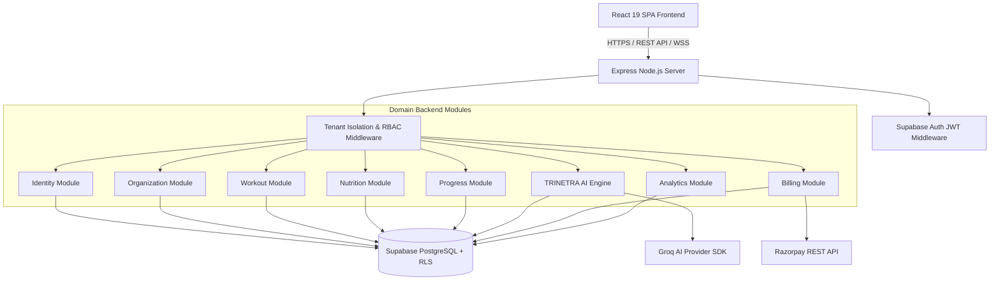

# STRIVA V2 — SYSTEM ARCHITECTURE SPECIFICATION

## 1. HIGH-LEVEL SYSTEM ARCHITECTURE

STRIVA V2 is structured as a single monorepo separating a modern React Single Page Application (SPA) frontend from a domain-driven modular Express backend, connected to Supabase PostgreSQL.



---

## 2. UNIFIED TECH STACK SPECIFICATION

### Frontend Stack
- **Framework**: React 19.0.0 + Vite 6.4.3
- **Routing**: React Router DOM v7
- **Styling**: Tailwind CSS v4 + Lucide Icons + Motion (Framer Motion)
- **Data Management**: TanStack React Query v5 + Axios Client + Supabase JS Client
- **Single Design System**: `src/design-system` (Tokens, Shell, Primitives)

### Backend Stack
- **Runtime**: Node.js + TypeScript (executed via `tsx` / compiled via `tsc`)
- **Server Framework**: Express v4
- **Security & Logging**: Helmet, CORS, Compression, Pino HTTP Logger, Zod schema validator
- **Auth Engine**: Supabase Auth (JWT bearer verification)
- **Integrations**: Groq SDK (`groq-sdk`), Razorpay REST Client

### Database & Infrastructure
- **Database Engine**: PostgreSQL 15+ (Hosted on Supabase)
- **Migrations Directory**: `backend/supabase/migrations/`
- **Security Layer**: PostgreSQL Row Level Security (RLS)

---

## 3. TARGET FRONTEND ARCHITECTURE (`src/`)

```
src/
├── api/                  # Unified Axios HTTP domain callers
│   ├── httpClient.ts     # Base Axios instance with Bearer token interceptor
│   ├── authApi.ts        # Auth & Profile calls
│   ├── workoutApi.ts     # Workout & Exercise calls
│   ├── nutritionApi.ts   # Nutrition & Water calls
│   ├── progressApi.ts    # Analytics & Body metrics
│   ├── coachApi.ts       # TRINETRA AI chat & tool triggers
│   ├── gymApi.ts         # Gym Owner member & attendance APIs
│   └── billingApi.ts     # Razorpay checkout & subscription APIs
├── context/              # Global React Contexts
│   ├── AuthContext.tsx   # Supabase Auth user session state
│   └── ThemeContext.tsx  # Dark theme tokens state
├── design-system/        # CANONICAL SINGLE DESIGN SYSTEM
│   ├── tokens/           # Colors, typography, spacing, shadows
│   ├── primitives/       # Button, Card, Input, Modal, Badge, StatRing
│   └── shell/            # AppShell, TopNav, MobileDock, GymSidebar
├── views/                # TOP-LEVEL PAGE VIEWS
│   ├── member/           # HomeView, CoachView, WorkoutView, NutritionView, ProgressView, ProfileView
│   └── gym/              # OwnerHomeView, MembersView, AttendanceView, TrainersView, BillingView
├── hooks/                # Custom React Hooks & TanStack Query hooks (NO MOCK FALLBACKS)
├── lib/                  # Supabase client & utility helpers
├── router/               # React Router index setup
└── App.tsx               # Main Application Root
```

---

## 4. TARGET BACKEND ARCHITECTURE (`backend/src/`)

```
backend/src/
├── app/                  # Express application setup & static server fallback
│   ├── app.ts
│   └── health.ts
├── config/               # Zod validated environment configuration
│   └── env.ts
├── database/             # Supabase database client initialization
│   └── supabase.ts
├── errors/               # Custom AppError hierarchy (AuthError, ForbiddenError, NotFoundError)
│   └── AppError.ts
├── middleware/           # Core HTTP Middlewares
│   ├── auth.middleware.ts        # JWT verification (requireAuth, requireAdmin)
│   ├── rbac.middleware.ts        # Role-Based Access Control checks
│   ├── tenant.middleware.ts      # Strict database-backed tenant isolation
│   ├── security.middleware.ts    # Helmet, rate limiting, correlation IDs
│   └── errorHandler.middleware.ts# Global error catch & JSON formatter
└── modules/              # DOMAIN-DRIVEN MODULES
    ├── identity/         # User profiles & preferences
    ├── organization/     # Multi-tenant gym organizations & locations
    ├── members/          # Gym member directory & memberships
    ├── workout/          # Workout plans, active sessions, sets execution
    ├── nutrition/        # Daily meals, macros, hydration
    ├── progress/         # Body metrics, 1RM stats, milestones
    ├── ai/               # TRINETRA Agent Runner, Tool Registry, Prompts
    ├── billing/          # Razorpay Checkout, Webhooks, Subscriptions
    ├── attendance/       # QR turnstile check-ins & expected occupancy
    ├── trainers/         # Trainer capacity & client assignments
    └── analytics/        # Business KPIs & revenue trends
```

### Standard Module Design Pattern
Each domain module within `backend/src/modules/<module-name>/` must strictly follow this internal structure:
- `routes.ts`: Express router defining endpoints and attaching validation & auth middlewares.
- `controllers/`: Request handlers parsing input payloads and returning JSON responses.
- `services/`: Core business logic rules, domain calculations, and workflow coordination.
- `repositories/`: Database access methods targeting Supabase/PostgreSQL tables.
- `schemas/`: Zod schemas for input validation (params, query, body).
- `types/`: TypeScript interfaces and type declarations.
- `__tests__/`: Unit and integration test suites for the module.
