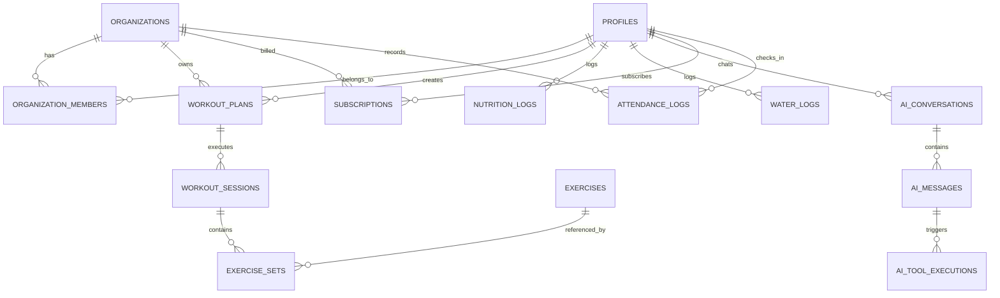

# STRIVA V2 — DATABASE SPECIFICATION

## 1. MIGRATION GOVERNANCE & SOURCE OF TRUTH

- **Canonical Migration Location**: `backend/supabase/migrations/`
- **Rule**: All database changes in STRIVA V2 must be authored as timestamped SQL migration files placed exclusively in `backend/supabase/migrations/`.
- **Prohibited**: Direct edits via Supabase Web Dashboard, unversioned root `.sql` files, or running DDL commands directly in production without a checked-in migration file.

---

## 2. CANONICAL DATABASE SCHEMA & TABLES



### 2.1 Identity Domain
- **`public.profiles`**: Primary user profile mapped 1:1 to Supabase `auth.users(id)`.
  - Columns: `id (UUID, PK)`, `email (TEXT)`, `full_name (TEXT)`, `avatar_url (TEXT)`, `fitness_level (TEXT)`, `primary_goal (TEXT)`, `created_at (TIMESTAMPTZ)`, `updated_at (TIMESTAMPTZ)`.
- **`public.member_goals`**: Active target goals for body weight, daily macros, and strength benchmarks.

### 2.2 Multi-Tenant Organization Domain
- **`public.organizations`**: Gym tenant entities.
  - Columns: `id (UUID, PK)`, `name (TEXT)`, `slug (TEXT, UNIQUE)`, `owner_id (UUID -> profiles.id)`, `created_at (TIMESTAMPTZ)`.
- **`public.organization_members`**: RBAC user membership mapping.
  - Columns: `id (UUID, PK)`, `organization_id (UUID -> organizations.id)`, `user_id (UUID -> profiles.id)`, `role (TEXT)`, `created_at (TIMESTAMPTZ)`.
- **`public.organization_locations`**: Physical gym branch locations.

### 2.3 Exercise & Workout Domain
- **`public.exercises`**: Master catalog of exercises with muscle targeting.
  - Columns: `id (UUID, PK)`, `name (TEXT)`, `category (TEXT)`, `primary_muscle (TEXT)`, `equipment (TEXT)`, `instructions (TEXT)`.
- **`public.workout_plans`**: Workout routines/templates.
  - Columns: `id (UUID, PK)`, `organization_id (UUID, NULLABLE)`, `user_id (UUID -> profiles.id)`, `title (TEXT)`, `split (TEXT)`, `is_public (BOOLEAN)`.
- **`public.workout_sessions`**: Active or completed workout log sessions.
  - Columns: `id (UUID, PK)`, `user_id (UUID -> profiles.id)`, `plan_id (UUID -> workout_plans.id)`, `started_at (TIMESTAMPTZ)`, `completed_at (TIMESTAMPTZ)`, `duration_seconds (INT)`, `total_volume_kg (NUMERIC)`.
- **`public.exercise_sets`**: Individual exercise set execution entries.
  - Columns: `id (UUID, PK)`, `session_id (UUID -> workout_sessions.id)`, `exercise_id (UUID -> exercises.id)`, `set_number (INT)`, `weight_kg (NUMERIC)`, `reps (INT)`, `rpe (NUMERIC)`.

### 2.4 Nutrition & Progress Domain
- **`public.nutrition_logs`**: Daily meal and macro logs.
  - Columns: `id (UUID, PK)`, `user_id (UUID -> profiles.id)`, `meal_name (TEXT)`, `calories (INT)`, `protein_g (NUMERIC)`, `carbs_g (NUMERIC)`, `fats_g (NUMERIC)`, `logged_at (TIMESTAMPTZ)`.
- **`public.water_logs`**: Water intake entries.
  - Columns: `id (UUID, PK)`, `user_id (UUID -> profiles.id)`, `amount_ml (INT)`, `logged_at (TIMESTAMPTZ)`.
- **`public.progress_snapshots`**: Body metric snapshots (weight, body fat %, muscle mass).

### 2.5 TRINETRA AI Domain
- **`public.ai_conversations`**: Chat thread sessions between members and TRINETRA.
- **`public.ai_messages`**: Chat prompt/response messages with token metadata.
- **`public.ai_memory`**: Long-term user preferences and health facts extracted by TRINETRA.
- **`public.ai_tool_executions`**: Audit trail of tool calls made by TRINETRA.
- **`public.ai_usage`**: Per-user and per-org token usage and latency logs.

### 2.6 Billing & Operations Domain
- **`public.subscriptions`**: Razorpay subscription state tracking.
  - Columns: `id (UUID, PK)`, `user_id (UUID -> profiles.id)`, `organization_id (UUID, NULLABLE)`, `provider (TEXT)`, `subscription_id (TEXT)`, `tier (TEXT)`, `status (TEXT)`, `current_period_end (TIMESTAMPTZ)`.
- **`public.attendance_logs`**: Gym turnstile and QR code check-in logs.
  - Columns: `id (UUID, PK)`, `organization_id (UUID -> organizations.id)`, `user_id (UUID -> profiles.id)`, `check_in_time (TIMESTAMPTZ)`, `check_in_method (TEXT)`.

---

## 3. ROW LEVEL SECURITY (RLS) POLICY SPECIFICATION

Every table containing tenant-owned or user-owned data **MUST** enable PostgreSQL RLS (`ALTER TABLE <table> ENABLE ROW LEVEL SECURITY;`).

### Standard Policy Patterns
1. **User Ownership Policy**:
   ```sql
   CREATE POLICY "Users access own data" ON public.nutrition_logs
     FOR ALL USING (auth.uid() = user_id);
   ```
2. **Organization Tenant Boundary Policy**:
   ```sql
   CREATE POLICY "Tenant Members Read Access" ON public.workout_plans
     FOR SELECT USING (
       organization_id IS NULL OR
       organization_id IN (
         SELECT organization_id FROM public.organization_members WHERE user_id = auth.uid()
       )
     );
   ```

---

## 4. OBSOLETE TABLES & DEPRECATION PLAN

The following legacy tables from V1 and experimental builds are flagged for **SAFE DEPRECATION & DELETION**:
- `users` (V1 integer primary key table) -> Superceded by `profiles`.
- `fitness_profiles` (V1 integer foreign key table) -> Superceded by `profiles`.
- `daily_plans` (V1 unindexed plan table) -> Superceded by `workout_plans`.
- `workout_logs` (V1 raw logs) -> Superceded by `exercise_sets`.
- `v2_fitness_profiles` -> Merged into `profiles`.
- `v2_workout_sessions` -> Consolidated into `workout_sessions`.
