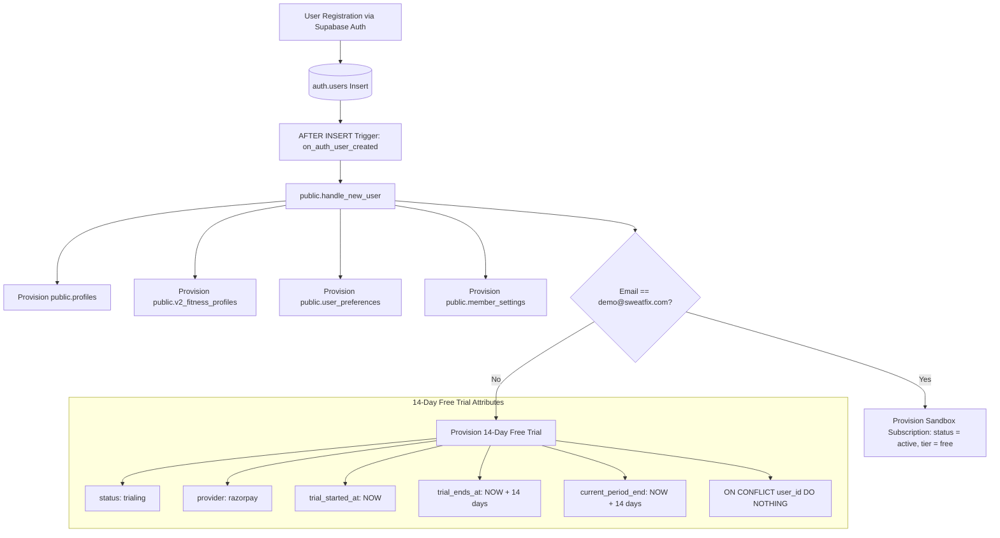

# STRIVA V2 — PHASE 7.5B DATABASE FOUNDATION

## Objective

Establish the canonical, server-authoritative database foundation for STRIVA V2's monetization model:
```
14-DAY FREE TRIAL  ──>  PAID SUBSCRIPTION  ──>  CENTRAL ENTITLEMENT SYSTEM
```
This phase introduces additive subscription schema enhancements, Razorpay provider identifiers, 14-day trial lifecycle fields, database constraints, performance indexes, safe auto-provisioning triggers, and automated security invariant test coverage without modifying frontend gating, entitlement middleware, or external payment gateways.

---

## Existing Billing Schema

Prior to Phase 7.5B, the billing foundation established in `phase_7a_billing.sql` defined:
- **`public.subscriptions`**:
  - `id UUID PRIMARY KEY DEFAULT gen_random_uuid()`
  - `user_id UUID NOT NULL REFERENCES auth.users(id) ON DELETE CASCADE UNIQUE`
  - `tier subscription_tier DEFAULT 'free' NOT NULL` (`'free'`, `'pro'`, `'elite'`)
  - `interval billing_interval DEFAULT 'monthly' NOT NULL` (`'monthly'`, `'yearly'`)
  - `status subscription_status DEFAULT 'active' NOT NULL` (`'active'`, `'past_due'`, `'canceled'`, `'trialing'`, `'incomplete'`)
  - `stripe_customer_id TEXT UNIQUE` (Legacy naming)
  - `stripe_subscription_id TEXT UNIQUE` (Legacy naming)
  - `current_period_start TIMESTAMPTZ DEFAULT now() NOT NULL`
  - `current_period_end TIMESTAMPTZ DEFAULT (now() + INTERVAL '1 month') NOT NULL`
  - `cancel_at_period_end BOOLEAN DEFAULT false NOT NULL`
  - `canceled_at TIMESTAMPTZ`
  - `created_at TIMESTAMPTZ`, `updated_at TIMESTAMPTZ`
- **`public.invoices`**: Invoices table mapped to `user_id` and `subscription_id`.
- **`public.payment_events`**: Idempotent audit store for webhook payloads.
- **`public.feature_usage`**: Per-user daily/monthly quota tracker.

### Deficiencies Addressed:
1. No trial start or expiration timestamps existed on `subscriptions`.
2. No Razorpay provider identity fields existed (`razorpay_customer_id`, `razorpay_subscription_id`, `razorpay_payment_id`).
3. New accounts were automatically backfilled or defaulted to an indefinite `'free'` tier rather than entering a bounded 14-day trial.

---

## Migration Created

**File**: `backend/supabase/migrations/phase_7b_trial_foundation.sql`

This migration is strictly additive and backwards-compatible. It preserves historical legacy columns (`stripe_customer_id`, `stripe_subscription_id`) to prevent regressions across any existing queries.

---

## New Fields

All additive columns are applied to `public.subscriptions`:

| Field Name | Data Type | Nullable | Purpose |
| :--- | :--- | :---: | :--- |
| `trial_started_at` | `TIMESTAMPTZ` | **YES** | Exact server timestamp when the 14-day trial was provisioned. Nullable to support existing legacy or paid users. |
| `trial_ends_at` | `TIMESTAMPTZ` | **YES** | Exact server timestamp when the 14-day trial expires (`trial_started_at + INTERVAL '14 days'`). Authoritative anchor for Phase 7.5C entitlement evaluations. |
| `provider` | `TEXT` | **NO** (`DEFAULT 'razorpay'`) | Primary payment gateway provider name. Standardizes STRIVA V2 on Razorpay while recording payment gateway ownership. |
| `razorpay_customer_id` | `TEXT` | **YES** | Canonical Razorpay Customer ID (`cust_*`), enforcing `UNIQUE` constraint. |
| `razorpay_subscription_id` | `TEXT` | **YES** | Canonical Razorpay Subscription ID (`sub_*`), enforcing `UNIQUE` constraint. |
| `razorpay_payment_id` | `TEXT` | **YES** | Latest verified Razorpay Payment ID (`pay_*`) associated with the active subscription cycle. |

---

## Trial Provisioning

New user accounts receive their 14-day free trial directly at the database layer through the updated `public.handle_new_user()` trigger:



### Idempotency & Safety Guarantees:
- **`ON CONFLICT (user_id) DO NOTHING`**: Ensures that subsequent logins, profile re-synchronization, token renewals, or trigger re-executions **NEVER** overwrite, restart, or extend an ongoing or expired trial.
- **`SECURITY DEFINER SET search_path = public`**: Prevents schema search_path hijacking attacks by securing function execution to the trusted `public` schema.

---

## Existing User Handling

To prevent data loss or accidental lockouts:
1. **No Destructive Updates**: The migration executes zero blanket updates that alter existing subscription statuses or tiers.
2. **Provider Alignment**:
   ```sql
   UPDATE public.subscriptions
   SET provider = 'razorpay'
   WHERE provider IS NULL;
   ```
   Ensures historical records have a valid provider value without mutating lifecycle states.
3. **Controlled Backfill Strategy**: Any migration of legacy test accounts from `tier = 'free'` to active trial or expired states will be governed by the Phase 7.5C Entitlement Service rather than a destructive database batch update.

---

## Demo User Handling

- **Account**: `demo@sweatfix.com`
- **Behavior**: The updated `handle_new_user()` trigger explicitly inspects `NEW.email = 'demo@sweatfix.com'`.
- **Policy**: Demo accounts are provisioned with:
  - `tier: 'free'`
  - `status: 'active'`
  - `trial_started_at: NULL`
  - `trial_ends_at: NULL`
  - `current_period_end: NOW() + INTERVAL '100 years'`
- **Isolation**: The Demo User does not receive a commercial trial countdown, cannot enter trial expiration, and will not generate Razorpay orders.

---

## Paid User Handling

Existing paid accounts (`tier IN ('pro', 'elite')` with active provider subscription IDs) remain completely untouched:
- `current_period_start` and `current_period_end` are preserved.
- `status` (`'active'`) is unchanged.
- `stripe_subscription_id` and legacy fields are maintained.
- `trial_started_at` and `trial_ends_at` remain `NULL`, correctly indicating an active paid subscription rather than a trial.

---

## RLS Verification

- `public.subscriptions` retains Row Level Security (`ENABLE ROW LEVEL SECURITY`).
- Existing Policy: `"Users read own subscription"` (`FOR SELECT USING (auth.uid() = user_id)`).
- **Client Mutation Lockdown**: No `INSERT`, `UPDATE`, or `DELETE` policies exist for normal authenticated users. Normal members cannot manipulate `trial_started_at`, `trial_ends_at`, or `status` via the client Supabase SDK.
- Backend services using `supabaseAdmin` (service role) bypass RLS as intended.

---

## Constraints

1. **`chk_subscriptions_trial_dates`**:
   ```sql
   CHECK (trial_ends_at IS NULL OR trial_started_at IS NULL OR trial_ends_at >= trial_started_at)
   ```
   Ensures expiration dates cannot precede start dates, while remaining completely compatible with legacy records where trial fields are `NULL`.
2. **Unique Constraints**:
   - `subscriptions_razorpay_customer_id_key UNIQUE (razorpay_customer_id)`
   - `subscriptions_razorpay_subscription_id_key UNIQUE (razorpay_subscription_id)`

---

## Indexes

1. `idx_subscriptions_trial_ends_at ON public.subscriptions(trial_ends_at)`: Optimizes server-side expiration queries in Phase 7.5C.
2. `idx_subscriptions_provider ON public.subscriptions(provider)`: Enables fast provider lookups.
3. `idx_subscriptions_razorpay_sub_id ON public.subscriptions(razorpay_subscription_id)`: Accelerates webhook lookups when processing Razorpay subscription lifecycle events.

---

## Migration Safety

- **Non-breaking**: All column additions use `ADD COLUMN IF NOT EXISTS`.
- **Constraint Safety**: Uses `pg_constraint` lookups with `EXCEPTION WHEN duplicate_object THEN null` blocks.
- **Trigger Integrity**: Preserves all existing profile, fitness profile, preference, and setting creation queries.

---

## Tests

A dedicated security and migration test suite was created in:
`backend/tests/security/trial_foundation.security.test.ts`

### Invariant Test Cases Verified:
1. **TEST 1**: New user provisioning inserts a trial subscription in `'trialing'` status.
2. **TEST 2**: Trial duration is set to exactly 14 days from `trial_started_at`.
3. **TEST 3**: `ON CONFLICT (user_id) DO NOTHING` prevents trial reset upon re-provisioning.
4. **TEST 4**: Existing active paid user records are not converted to trial.
5. **TEST 5**: Demo user (`demo@sweatfix.com`) is isolated from commercial trial provisioning.
6. **TEST 6**: All schema modifications are strictly additive (`ADD COLUMN IF NOT EXISTS`).
7. **TEST 7**: RLS allows only `SELECT` for users; `INSERT`, `UPDATE`, and `DELETE` are denied.
8. **TEST 8**: RLS prevents cross-user subscription access (`auth.uid() = user_id`).
9. **TEST 9**: `chk_subscriptions_trial_dates` constraint validates successfully for nullable records.
10. **TEST 10**: `handle_new_user()` enforces `SECURITY DEFINER SET search_path = public`.
11. **TEST 11**: Performance indexes exist for `trial_ends_at` and `razorpay_subscription_id`.

**Result**: 11 / 11 tests passed in 5ms. Full test suite (15 test files, 168 tests) passed with zero regressions.

---

## Database Verification

- **Static & Syntax Validation**: **YES** (Automated SQL syntax, migration dependency, and constraint invariants validated via Vitest).
- **Live Remote Database Verification**: **NO** (Production database was not mutated; all changes are versioned SQL scripts in `backend/supabase/migrations/` per STRIVA engineering rules).

---

## Files Created

1. `backend/supabase/migrations/phase_7b_trial_foundation.sql`
2. `backend/tests/security/trial_foundation.security.test.ts`
3. `docs/STRIVA_V2_PHASE_7_5B_DATABASE_FOUNDATION.md`

---

## Files Modified

1. `backend/src/modules/billing/domain/BillingSchemas.ts` (Added optional trial and Razorpay provider fields to TypeScript `Subscription` interface).

---

## Files Deleted

**NONE**

---

## Out of Scope

The following components were **NOT** implemented in this phase and remain planned for subsequent milestones:
- **EntitlementService**: NOT IMPLEMENTED (Phase 7.5C)
- **Entitlement Middleware** (`requireActiveEntitlement`): NOT IMPLEMENTED (Phase 7.5C)
- **Frontend Gating** (`ProtectedRoute`, lock screens): NOT IMPLEMENTED (Phase 7.5E)
- **Razorpay Changes** (Provider / webhook modifications): NOT IMPLEMENTED (Phase 7.5D)
- **Pricing Changes** (Single-tier pricing UX): NOT IMPLEMENTED (Phase 7.5F)
- **Workout Engine**: NOT MODIFIED
- **Nutrition Engine**: NOT MODIFIED
- **Progress Analytics**: NOT MODIFIED
- **Profile UI**: NOT MODIFIED
- **TRINETRA AI Engine**: NOT MODIFIED
