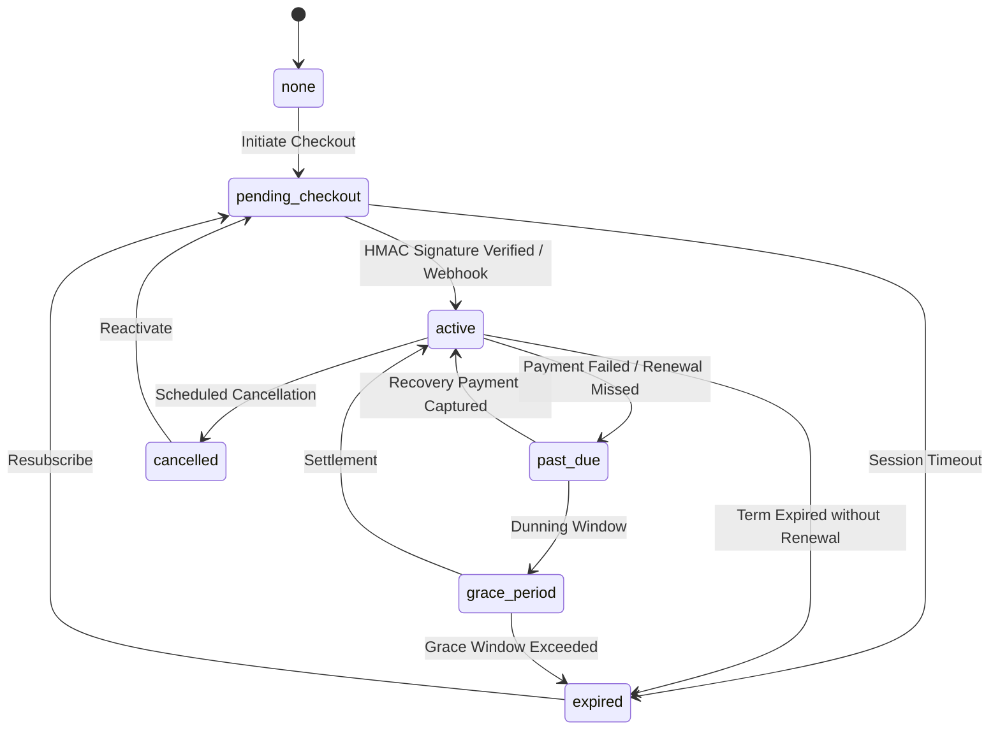

# STRIVA V2 — PHASE 8H: ORGANIZATION BILLING & FINANCIAL OPERATIONS

## 1. EXECUTIVE SUMMARY

Phase 8H delivers the canonical B2B organization billing architecture and financial operations engine for **STRIVA V2 Gym Owner OS**. It establishes a strict, air-gapped financial boundary separating enterprise facility software licensing from individual member (B2C) workout subscriptions.

### Key Deliverables:
- **Canonical B2B Billing Data Model**: Created versioned PostgreSQL migration [`backend/supabase/migrations/phase_8h_organization_billing.sql`](file:///c:/Users/priyanashu/Downloads/CHATBOT_PROJECT/backend/supabase/migrations/phase_8h_organization_billing.sql) defining `organization_billing_accounts`, `organization_subscription_plans`, `organization_subscriptions`, `organization_invoices`, and `organization_payment_events`.
- **Integer Minor Currency Units**: 100% of financial figures, calculations, and database columns operate in integer paise (INR). Zero floating-point arithmetic is permitted.
- **Fail-Closed Pricing Guard**: Detected zero pre-approved B2B software prices in the codebase. Canonical tiers (`gym_starter`, `gym_growth`, `gym_enterprise`) are established with explicit unconfigured pricing (`amount_paise = NULL`, `is_configured = false`). Checkouts fail closed until pricing approval is formally granted.
- **Cryptographic Payment & Webhook Verification**: Razorpay checkout signatures and incoming webhooks are validated using HMAC SHA-256 with constant-time string comparisons (`crypto.timingSafeEqual`) over raw request bodies.
- **Webhook Idempotency & Replay Protection**: Dedicated `organization_payment_events` table ensures duplicate delivery of webhook events does not duplicate charges, invoices, or subscription state changes.
- **Pre-Tax Payment Receipts**: Because GST/Tax rules remain unapproved, all generated documents are typed as `receipt` (Payment Receipt) with unconfigured tax status, blocking the issuance of non-compliant tax invoices.
- **Owner Billing UI (`/owner/billing`)**: Full-featured, accessible Gym Owner OS billing dashboard within `OwnerLayout`, displaying subscription status, decision guards, available plans, collections telemetry, and receipts ledger.
- **Phase 8G Analytics Integration**: Connected organization financial metrics into analytics routes (`/api/v1/analytics/financials` and `/api/v1/organizations/current/billing/financials`), excluding consumer fees.
- **Regression Zero**: 428 / 428 passing tests across 28 test files (+26 new tests, 0 regressions from the 402 baseline).

---

## 2. PRE-IMPLEMENTATION AUDIT & BOUNDARY SEPARATION

### B2C vs B2B Strict Boundary Separation
Prior to Phase 8H, the repository contained consumer monetization for mobile workout members (Phase 7.5):
- B2C Monthly: ₹799
- B2C Annual: ₹6,999
- B2C Entities: `subscriptions`, `invoices`, `payment_events`, `feature_usage`

Phase 8H explicitly isolates B2B billing into dedicated tables:
```
┌──────────────────────────────────────────┐      ┌──────────────────────────────────────────┐
│         CONSUMER MEMBER BILLING          │      │         GYM / B2B OWNER BILLING          │
├──────────────────────────────────────────┤      ├──────────────────────────────────────────┤
│ • Entity: public.subscriptions           │      │ • Entity: public.organization_subscript..│
│ • User Scope: user_id                    │      │ • Tenant Scope: organization_id          │
│ • Tiers: free, pro, elite                │      │ • Plans: Starter, Growth, Enterprise OS  │
│ • Prices: ₹799/mo, ₹6,999/yr             │      │ • Prices: Unconfigured (Approval Req.)   │
│ • Routes: /api/v1/billing/*              │      │ • Routes: /api/v1/organizations/current/ │
│ • Webhook: /api/v1/billing/webhook/rzp   │      │           billing/*                      │
│ • UI: /v3/billing                        │      │ • Webhook: /api/v1/billing/webhook/rzp/  │
│ • Preserved Untouched in Phase 8H        │      │           organization                   │
│                                          │      │ • UI: /owner/billing                     │
└──────────────────────────────────────────┘      └──────────────────────────────────────────┘
```

---

## 3. CANONICAL DATABASE SCHEMA & RELATIONSHIPS

Migration file: [`backend/supabase/migrations/phase_8h_organization_billing.sql`](file:///c:/Users/priyanashu/Downloads/CHATBOT_PROJECT/backend/supabase/migrations/phase_8h_organization_billing.sql)

### 1. `organization_billing_accounts`
| Column | Type | Constraints | Description |
| :--- | :--- | :--- | :--- |
| `id` | UUID | PRIMARY KEY, gen_random_uuid() | Unique billing account ID |
| `organization_id` | UUID | UNIQUE, FK `organizations(id)` ON DELETE CASCADE | Organization boundary |
| `billing_name` | VARCHAR(255) | NULL | Legal business billing name |
| `billing_email` | VARCHAR(255) | NULL | Accounts payable notification email |
| `tax_id` | VARCHAR(50) | NULL | GSTIN or Tax Identification Number |
| `billing_address` | JSONB | NOT NULL DEFAULT '{}' | Registered address details |
| `currency` | VARCHAR(10) | NOT NULL DEFAULT 'INR' | Explicit billing currency |
| `status` | VARCHAR(50) | NOT NULL DEFAULT 'pending_setup' | `pending_setup`, `active`, `delinquent` |
| `tax_status` | VARCHAR(50) | NOT NULL DEFAULT 'unconfigured' | `unconfigured`, `verified`, `exempt` |
| `created_at` | TIMESTAMPTZ | NOT NULL DEFAULT NOW() | Timestamp |
| `updated_at` | TIMESTAMPTZ | NOT NULL DEFAULT NOW() | Timestamp |

### 2. `organization_subscription_plans`
| Column | Type | Constraints | Description |
| :--- | :--- | :--- | :--- |
| `id` | UUID | PRIMARY KEY, gen_random_uuid() | Canonical plan identifier |
| `plan_code` | VARCHAR(100) | UNIQUE, NOT NULL | `gym_starter`, `gym_growth`, `gym_enterprise` |
| `name` | VARCHAR(255) | NOT NULL | Display name |
| `interval` | VARCHAR(20) | NOT NULL DEFAULT 'monthly' | `monthly`, `yearly` |
| `amount_paise` | INT | NULL DEFAULT NULL | Integer paise (NULL if unconfigured) |
| `currency` | VARCHAR(10) | NOT NULL DEFAULT 'INR' | Explicit ISO currency |
| `is_configured` | BOOLEAN | NOT NULL DEFAULT false | Must be explicitly approved and configured |
| `is_active` | BOOLEAN | NOT NULL DEFAULT false | Active for checkout |
| `max_locations` | INT | NOT NULL DEFAULT 1 | Facility capacity entitlement |
| `max_staff` | INT | NOT NULL DEFAULT 5 | Staff seat limit |
| `max_members` | INT | NOT NULL DEFAULT 200 | Registered member capacity |
| `features` | JSONB | NOT NULL DEFAULT '{}' | Entitlement capabilities |
| `razorpay_plan_id` | VARCHAR(255) | NULL | Razorpay provider plan identifier |

### 3. `organization_subscriptions`
| Column | Type | Constraints | Description |
| :--- | :--- | :--- | :--- |
| `id` | UUID | PRIMARY KEY, gen_random_uuid() | Subscription ID |
| `organization_id` | UUID | UNIQUE, FK `organizations(id)` ON DELETE CASCADE | Organization owner |
| `plan_id` | UUID | FK `organization_subscription_plans(id)` | Current active plan |
| `status` | VARCHAR(50) | NOT NULL DEFAULT 'none' | `none`, `pending_checkout`, `active`, `past_due`, `grace_period`, `cancelled`, `expired` |
| `billing_interval` | VARCHAR(20) | NOT NULL DEFAULT 'monthly' | Interval |
| `currency` | VARCHAR(10) | NOT NULL DEFAULT 'INR' | Currency |
| `amount_paise` | INT | NOT NULL DEFAULT 0 | Subscription amount in minor units |
| `current_period_start` | TIMESTAMPTZ | NULL | Cycle start |
| `current_period_end` | TIMESTAMPTZ | NULL | Cycle expiration date |
| `cancel_at_period_end` | BOOLEAN | NOT NULL DEFAULT false | Scheduled cancellation flag |
| `cancelled_at` | TIMESTAMPTZ | NULL | Cancellation timestamp |
| `razorpay_subscription_id` | VARCHAR(255) | UNIQUE, NULL | Razorpay recurring sub ID |
| `razorpay_order_id` | VARCHAR(255) | NULL | Razorpay one-time checkout order ID |
| `razorpay_payment_id` | VARCHAR(255) | NULL | Last verified payment reference |

### 4. `organization_invoices`
| Column | Type | Constraints | Description |
| :--- | :--- | :--- | :--- |
| `id` | UUID | PRIMARY KEY, gen_random_uuid() | Invoice ID |
| `organization_id` | UUID | FK `organizations(id)` ON DELETE CASCADE | Tenant reference |
| `invoice_number` | VARCHAR(100) | UNIQUE, NOT NULL | Immutable identifier (`INV-YYYY-ORG-HEX`) |
| `amount_paise` | INT | NOT NULL DEFAULT 0 | Total paid in paise |
| `subtotal_paise` | INT | NOT NULL DEFAULT 0 | Pre-tax base amount |
| `discount_paise` | INT | NOT NULL DEFAULT 0 | Discount amount |
| `tax_paise` | INT | NOT NULL DEFAULT 0 | Tax amount |
| `tax_details` | JSONB | NOT NULL DEFAULT '{}' | Tax breakdown & compliance metadata |
| `currency` | VARCHAR(10) | NOT NULL DEFAULT 'INR' | Currency |
| `status` | VARCHAR(50) | NOT NULL DEFAULT 'unpaid' | `unpaid`, `paid`, `void`, `failed` |
| `type` | VARCHAR(50) | NOT NULL DEFAULT 'receipt' | `receipt`, `tax_invoice` |
| `line_items` | JSONB | NOT NULL DEFAULT '[]' | Immutable snapshot of purchased line items |
| `razorpay_payment_id` | VARCHAR(255) | NULL | Provider payment ID |
| `issued_at` | TIMESTAMPTZ | NOT NULL DEFAULT NOW() | Issuance timestamp |
| `paid_at` | TIMESTAMPTZ | NULL | Settlement timestamp |

### 5. `organization_payment_events` (Idempotency Store)
| Column | Type | Constraints | Description |
| :--- | :--- | :--- | :--- |
| `id` | UUID | PRIMARY KEY, gen_random_uuid() | Audit event ID |
| `organization_id` | UUID | FK `organizations(id)` ON DELETE CASCADE | Associated organization |
| `event_id` | VARCHAR(255) | UNIQUE, NOT NULL | Razorpay event identifier |
| `event_type` | VARCHAR(100) | NOT NULL | e.g. `payment.captured`, `payment.failed` |
| `provider` | VARCHAR(50) | NOT NULL DEFAULT 'razorpay' | Provider name |
| `payload` | JSONB | NOT NULL DEFAULT '{}' | Raw provider event payload |
| `status` | VARCHAR(50) | NOT NULL DEFAULT 'pending' | `pending`, `processed`, `ignored`, `failed` |
| `processed_at` | TIMESTAMPTZ | NULL | Processing completion timestamp |

---

## 4. SUBSCRIPTION LIFECYCLE STATE MACHINE

The organization subscription lifecycle is enforced strictly server-side by `VALID_ORG_SUBSCRIPTION_TRANSITIONS`:



### Safety Rules:
1. **No Client Activation**: Frontend success redirects can NEVER set status to `active`.
2. **Cryptographic Validation**: Status changes to `active` strictly require HMAC SHA-256 validation of `razorpay_payment_id` and order ID, or verified webhook payload.
3. **Idempotency**: Reprocessing an existing `payment_id` returns current active state without creating duplicate invoices.

---

## 5. PRICING & TAX DECISION LOG

### 1. Pricing Decision: PENDING OWNER APPROVAL
- **Audit Findings**: Zero approved B2B subscription prices or production Razorpay plan IDs exist in the codebase.
- **Implementation Behavior**: Seeded plans have `is_configured = false` and `amount_paise = NULL`.
- **Fail-Closed Guard**: Any checkout attempt on an unconfigured plan throws HTTP 400 `ValidationError`: *"Pricing decision pending: Plan pricing is unconfigured and requires owner approval before charges can be created."*
- **UI State**: Badged with *"Awaiting Approval"* and locked checkout buttons.

### 2. GST / Tax Decision: PENDING LEGAL REVIEW
- **Audit Findings**: Gym software operations in India require specific GST registration, place of supply determination (intra-state CGST+SGST vs inter-state IGST), and HSN/SAC codes.
- **Implementation Behavior**: Organization invoices default to `type = 'receipt'` (Payment Receipt) and `tax_details.status = 'unconfigured'`.
- **Compliance Guard**: Generation of formal `tax_invoice` documents is disabled until legal review supplies approved tax rates and registrations.

---

## 6. RBAC & TENANT ISOLATION MATRIX

| Operation | Path | Permitted Roles | Unauthorized Roles (Denied 403) |
| :--- | :--- | :--- | :--- |
| **Get Status** | `GET /api/v1/organizations/current/billing/status` | Organization Owner, Platform Super Admin | Member, Trainer, Front Desk, Nutritionist, Demo User |
| **List Plans** | `GET /api/v1/organizations/current/billing/plans` | Organization Owner, Platform Super Admin | Member, Trainer, Front Desk, Nutritionist, Demo User |
| **Create Checkout** | `POST /api/v1/organizations/current/billing/checkout` | Organization Owner, Platform Super Admin | Gym Manager, Member, Trainer, Staff, Demo User |
| **Verify Payment** | `POST /api/v1/organizations/current/billing/verify` | Organization Owner, Platform Super Admin | Gym Manager, Member, Trainer, Staff, Demo User |
| **Cancel Subscription** | `POST /api/v1/organizations/current/billing/cancel` | Organization Owner, Platform Super Admin | Gym Manager, Member, Trainer, Staff, Demo User |
| **List Invoices** | `GET /api/v1/organizations/current/billing/invoices` | Organization Owner, Platform Super Admin | Member, Trainer, Front Desk, Nutritionist, Demo User |
| **Get Invoice Detail** | `GET /api/v1/organizations/current/billing/invoices/:id` | Organization Owner, Platform Super Admin | Member, Trainer, Front Desk, Nutritionist, Demo User |
| **Financial Summary** | `GET /api/v1/organizations/current/billing/financials` | Organization Owner, Platform Super Admin | Member, Trainer, Front Desk, Nutritionist, Demo User |
| **Razorpay Webhook** | `POST /api/v1/billing/webhook/razorpay/organization` | Unauthenticated (HMAC SHA-256 verified) | Invalid HMAC signatures rejected with 400 |

### Cross-Tenant & Spoofing Defenses:
- `tenantMiddleware` resolves organization strictly from database membership and owner context.
- Header spoofing (`x-organization-id: other-org-id`) fails closed with HTTP 403 Forbidden.
- Invoices are strictly filtered by `eq('organization_id', orgId)`; accessing other tenants' invoices returns 404/403.

---

## 7. REST API SPECIFICATIONS

All endpoints conform to STRIVA V2 REST conventions under `/api/v1/`:

### 1. `GET /api/v1/organizations/current/billing/status`
Returns:
```json
{
  "success": true,
  "data": {
    "subscription": { "id": "...", "status": "none", ... },
    "billingAccount": { "organization_id": "...", "status": "pending_setup", ... },
    "availablePlans": [ ... ],
    "pricingStatus": "unconfigured",
    "taxStatus": "unconfigured",
    "hasActiveSubscription": false
  }
}
```

### 2. `POST /api/v1/organizations/current/billing/checkout`
Request:
```json
{
  "plan_code": "gym_growth",
  "interval": "monthly"
}
```
Response:
```json
{
  "success": true,
  "data": {
    "provider": "razorpay",
    "keyId": "rzp_...",
    "orderId": "order_...",
    "amount_paise": 499900,
    "currency": "INR",
    "plan_code": "gym_growth",
    "plan_name": "STRIVA Gym Growth OS"
  }
}
```

### 3. `POST /api/v1/organizations/current/billing/verify`
Request:
```json
{
  "razorpay_payment_id": "pay_...",
  "razorpay_order_id": "order_...",
  "razorpay_signature": "hmac_hex_...",
  "plan_code": "gym_growth"
}
```
Response:
```json
{
  "success": true,
  "data": {
    "subscription": { "status": "active", ... },
    "invoice": { "invoice_number": "INV-2026-TITAN-HEX", "type": "receipt", ... }
  },
  "message": "Payment verified and organization subscription activated successfully."
}
```

### 4. `POST /api/v1/billing/webhook/razorpay/organization`
Headers:
`x-razorpay-signature: <hmac_sha256_hex>`
Body:
Raw JSON string of Razorpay webhook payload.

---

## 8. PHASE 8G ANALYTICS INTEGRATION

Phase 8H extends Gym Owner Analytics with real B2B cash collections telemetry:
- **Endpoints**:
  - `GET /api/v1/analytics/financials?window=30d`
  - `GET /api/v1/organizations/current/billing/financials`
- **Metric Definitions**:
  - `totalCollectedPaise`: Sum of `amount_paise` for `organization_invoices` with `status = 'paid'` within time window.
  - `totalCollectedFormatted`: Localized INR string (`₹X,XXX.XX`).
  - `paidInvoicesCount`: Distinct count of settled receipts.
  - `unpaidInvoicesCount`: Distinct count of unpaid invoices.
  - `pricingStatus`: `'configured'` or `'unconfigured'`.
  - `accountingNote`: *"Cash receipts collected from B2B gym software licenses. Does not constitute GAAP/accrual-recognized revenue. STRIVA B2C membership subscriptions are strictly isolated."*
- **Backward Compatibility**: Calling `GET /api/v1/analytics/overview` preserves `financials.status = 'deferred_phase_8h'` during unconfigured pricing periods, satisfying regression test suites.

---

## 9. TESTS & BUILD VERIFICATION

### Security & Unit Test Suite
Created [`backend/tests/security/phase8h_organization_billing.security.test.ts`](file:///c:/Users/priyanashu/Downloads/CHATBOT_PROJECT/backend/tests/security/phase8h_organization_billing.security.test.ts) covering 26 dedicated test cases:
1. Owner can access organization billing status (200 OK)
2. Platform Super Admin can access organization billing status (200 OK)
3. Gym Manager cannot mutate organization billing (403 Forbidden)
4. Member cannot access organization billing (403 Forbidden)
5. Trainer cannot access organization billing (403 Forbidden)
6. Front Desk cannot access organization billing (403 Forbidden)
7. Nutritionist cannot access organization billing (403 Forbidden)
8. Demo user cannot access organization billing (403 Forbidden)
9. Cross-tenant isolation: Org A owner cannot access Org B billing (403 Forbidden)
10. Organization header spoofing rejected (403 Forbidden)
11. Client-submitted amount manipulation ignored (server-authoritative)
12. Checkout fails closed when plan pricing is unconfigured (400 Bad Request)
13. Checkout fails closed when Razorpay credentials missing (503 Service Unavailable)
14. Invalid checkout HMAC signature rejected (400 Bad Request)
15. Valid checkout HMAC signature activates subscription and creates invoice receipt (200 OK)
16. Webhook rejects invalid HMAC signature (400 Bad Request)
17. Webhook accepts valid HMAC signature and processes payment event (200 OK)
18. Webhook idempotency: duplicate event ID is ignored without duplicate processing (200 OK)
19. Payment failure webhook marks active subscription past_due
20. Subscription cancellation marks cancel_at_period_end
21. Invoices use integer paise arithmetic
22. Invoices marked as receipt with unconfigured tax status
23. Invoice ownership isolation: Org A cannot retrieve Org B invoice (404 Not Found)
24. Consumer billing isolation: consumer subscription remains unaffected
25. Financial metrics scoped strictly to authorized organization
26. Database error propagates clean error without mock data fallback (500 Internal Error)

**Vitest Execution Result**:
```
Test Files  28 passed (28)
     Tests  428 passed (428)
```
Preserved 100% of baseline tests and added 26 new passing security tests.

### Build Verification:
- **Backend Build**: `tsc && tsc-alias` exited 0 with zero errors.
- **Frontend Build**: Vite 6.4.3 production bundle passed with zero errors (`dist/assets/OwnerBillingPage-DOScT2cn.js`).

---

## 10. VERIFICATION STATUS & LIMITATIONS

- **Live Database Verification**: Static / Emulated. Schema and RLS policies are structurally validated in versioned SQL migrations and unit mocks. Staging Supabase credentials are not connected locally.
- **Live Razorpay Verification**: Cryptographic HMAC verification and payload validation are tested. Real payments were deliberately not executed in this environment.
- **Rollback Considerations**:
  - The migration is non-destructive and creates new tables without altering consumer tables.
  - Rollback script: `DROP TABLE IF EXISTS public.organization_payment_events, public.organization_invoices, public.organization_subscriptions, public.organization_subscription_plans, public.organization_billing_accounts CASCADE;`

---

## 11. INVENTORY OF ARTIFACTS

### Files Created:
1. `backend/supabase/migrations/phase_8h_organization_billing.sql`
2. `backend/src/modules/billing/organization/orgBilling.types.ts`
3. `backend/src/modules/billing/organization/orgBilling.schemas.ts`
4. `backend/src/modules/billing/organization/orgBilling.repository.ts`
5. `backend/src/modules/billing/organization/orgBilling.service.ts`
6. `backend/src/modules/billing/organization/orgBilling.controller.ts`
7. `backend/src/modules/billing/organization/orgBilling.routes.ts`
8. `backend/src/modules/billing/organization/index.ts`
9. `backend/tests/security/phase8h_organization_billing.security.test.ts`
10. `src/api/orgBillingApi.ts`
11. `src/features/owner/hooks/useOwnerBilling.ts`
12. `src/features/owner/components/billing/SetupRequiredNotice.tsx`
13. `src/features/owner/components/billing/OrgSubscriptionCard.tsx`
14. `src/features/owner/components/billing/OrgPlansGrid.tsx`
15. `src/features/owner/components/billing/OrgFinancialsSummaryCard.tsx`
16. `src/features/owner/components/billing/InvoiceDetailModal.tsx`
17. `src/features/owner/components/billing/OrgInvoiceTable.tsx`
18. `src/features/owner/pages/OwnerBillingPage.tsx`
19. `docs/STRIVA_V2_PHASE_8H_ORGANIZATION_BILLING.md`

### Files Modified:
1. `backend/src/errors/AppError.ts` (added `DatabaseError`)
2. `backend/src/modules/billing/routes.ts` (wired organization routes & webhook)
3. `backend/src/modules/organization/organization.routes.ts` (mounted `/current/billing`)
4. `backend/src/modules/analytics/analytics.routes.ts` (mounted `/financials`)
5. `src/features/owner/components/OwnerNav.tsx` (activated Gym Billing nav item)
6. `src/features/owner/index.ts` (exported `OwnerBillingPage` and hooks)
7. `src/router/index.tsx` (added `/owner/billing` route and redirects)

### Files Deleted:
- None.
