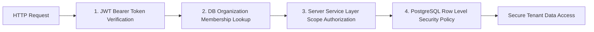

# STRIVA V2 — SECURITY SPECIFICATION

## 1. AUTHENTICATION MODEL

- **Primary Identity Provider**: Supabase Auth (OAuth 2.0 / Email-Password / Magic Link).
- **Session Tokens**: JSON Web Tokens (JWT) signed by Supabase Auth (`HS256`/`RS256`).
- **Authorization Transport**: `Authorization: Bearer <token>` in HTTP headers.
- **Server Verification**: Handled via `requireAuth` middleware using `@supabase/supabase-js` `supabase.auth.getUser(token)`.
- **Eliminated**: Express-session, Passport.js, cookie sessions, `connect-pg-simple`.

---

## 2. MULTI-TENANT ISOLATION MODEL

Multi-tenant data security must be strictly enforced at **two independent defense layers**:

### Critical Security Directives
1. **NO CLIENT HEADER TENANT TRUST**: Server code must **NEVER** trust `x-organization-id` or client body parameters to determine tenant access. Tenant identity **MUST** be derived exclusively by querying `organization_members` for the authenticated user ID (`auth.uid()`).
2. **NO HARDCODED FALLBACK ORGS**: Fallback string `'00000000-0000-0000-0000-000000000001'` is strictly **PROHIBITED** in production code. Unassigned tenant requests must fail closed (`403 Forbidden`).

---

## 3. ROLE-BASED ACCESS CONTROL (RBAC)

The system supports 8 distinct roles evaluated via verified JWT claims or database memberships:

| Role Name | Scope | Key Allowed Actions | Key Forbidden Actions |
| :--- | :--- | :--- | :--- |
| `Platform Super Admin` | Global System | Manage all tenants, global specs, system health | None |
| `Organization Owner` | Organization | Full tenant management, billing, staff setup | Access other tenant data |
| `Gym Manager` | Organization | Manage members, trainers, attendance, reports | Access billing credentials |
| `Trainer` | Org / Location | Manage assigned client workouts & progress | Modify gym billing/pricing |
| `Nutritionist` | Org / Location | Manage assigned client meal plans & macros | Modify workout templates |
| `Front Desk` | Location | Manage turnstile & member QR check-ins | View member billing details |
| `Member` | Individual User | View personal home, workout, nutrition, TRINETRA| View gym business metrics |
| `Demo User` | Read-only Sandbox| View sample member interface | Write/Modify database records |

---

## 4. BILLING & PAYMENT SECURITY (RAZORPAY)

- **HMAC Verification**: All Razorpay checkout payments and server webhooks **MUST** be verified using HMAC SHA-256 signatures (`RazorpayProvider.ts`).
- **Timing Attack Prevention**: Signature comparison **MUST** use `crypto.timingSafeEqual` constant-time string comparison.
- **Fail-Closed**: Invalid or missing webhook signatures return `400 Bad Request` and immediately halt execution. Simulated payment IDs or permissive signature bypasses are strictly **PROHIBITED**.

---

## 5. NETWORK & INFRASTRUCTURE SECURITY

- **Helmet**: Enforce HTTP Security Headers (HSTS, X-Frame-Options, X-Content-Type-Options, Referrer-Policy).
- **CORS**: Restrict allowed origins strictly to authorized client domains.
- **Rate Limiting**: Rate limiting middleware enforced on public auth & checkout endpoints.
- **Secrets Management**: Secrets (`SUPABASE_SERVICE_KEY`, `RAZORPAY_KEY_SECRET`) stored in environment variables, never checked into Git.
