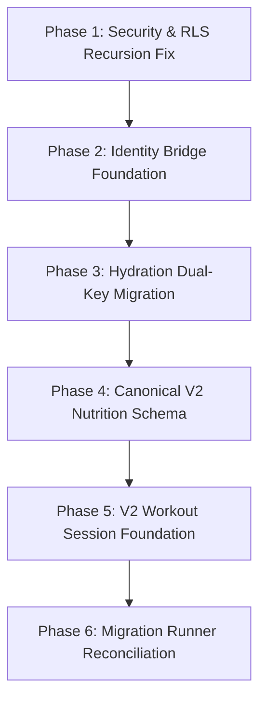

# STRIVA V2 — DB-1: Migration and Schema Reconciliation Audit Report

**Audit Date**: October 11, 2026  
**Auditor**: Antigravity AI Engineering Assistant  
**Target Environment**: Connected Supabase PostgreSQL Staging / Production Database (`db.ymrblyiwohvxptiqjfsi.supabase.co`)  
**Status**: COMPLETE (Read-Only Audit — Zero Remote DDL/DML Executed)  

---

## Executive Summary

This audit evaluates the database schema, migration history, foreign-key relationships, and Row-Level Security (RLS) policies of the STRIVA V2 application against its connected remote Supabase PostgreSQL database. 

The audit was conducted strictly in **read-only mode** using database catalog introspection queries through the existing authorized connection. **No DDL or DML statements were executed against the remote database**, no tables were dropped or modified, no data was deleted, and no personal user records were extracted or printed.

### High-Level Findings Overview

1. **Migration Tracking Inconsistency**: Standard Supabase CLI tracking (`supabase_migrations.schema_migrations`) does **not** exist in the remote database (`relation does not exist`). Migrations are tracked via an ad-hoc table `public._migrations` containing 21 applied records (10 legacy files from 2026-06-30 and 11 Phase 8 files from 2026-10-10). **13 migration files** in `backend/supabase/migrations/` have never been tracked or applied.
2. **Missing Nutrition Table (Blocker - PGRST205)**: `public.v2_nutrition_logs` does **not exist** in the live database schema. `NutritionRepository.ts` fails at runtime with `PGRST205: Could not find the table 'public.v2_nutrition_logs' in the schema cache`. The only live nutrition table is legacy `public.nutrition_logs` (0 rows), which has an integer foreign key to `public.users(id)` and incompatible column names.
3. **Hydration Foreign-Key Incompatibility (Blocker - 22P02)**: `public.water_logs` exists with **13 live rows**, but its foreign key `user_id` is an `integer` referencing legacy `public.users(id)`. Modern backend services pass Supabase Auth UUID strings (`a1bf8b11-e2c7-4f7f-9d36-5af53418e20b`) to `water_logs.user_id` and query column `amount_ml` (the live column is `intake_amount`). This triggers PostgreSQL error `22P02: invalid input syntax for type integer`.
4. **Identity Domain Split**: `public.users` (7 rows, integer PK) and `public.profiles` (5 rows, UUID PK referencing `auth.users(id)`) exist in parallel with no database-level foreign key or bridge mapping table. Exactly 3 user emails match between `public.users` and `public.profiles`. Of the 13 live `water_logs` rows, only 1 belongs to a user who currently exists in `profiles`; the remaining 12 belong to legacy users not yet present in `profiles`.
5. **RLS Policy Infinite Recursion Risk (Blocker - 42P17) — RESOLVED IN STAGING**: The legacy policy `"Staff managers manage organization members"` on `public.organization_members` contained a naked self-referential subquery on `organization_members`. On 2026-10-11, **Phase 9A was deployed and verified in staging** ([DB-2 Phase 1I Report](file:///c:/Users/priyanashu/Downloads/CHATBOT_PROJECT/docs/database/DB-2-phase-1I-staging-deployment-report.md)), replacing the recursive policy with `public.is_org_manager(UUID)` and eliminating error 42P17 across all evaluated roles.
6. **Hardcoded Tenant Default Violation**: `public.profiles.organization_id` has a default value of `'00000000-0000-0000-0000-000000000001'::uuid`, which directly violates STRIVA V2 Rule 6 prohibiting hardcoded fallback tenant IDs.
7. **Missing Workout V2 Table**: `public.v2_workout_sessions` does not exist in the database. `V2WorkoutSessionRepository.ts` queries `v2_workout_sessions`, while the live database only has legacy `public.workout_sessions` (0 rows, integer PK, integer `user_id`).

---

## 1. Repository and Migration Architecture

### 1.1 Project Root & Package Manager
- **Project Root**: `c:\Users\priyanashu\Downloads\CHATBOT_PROJECT`
- **Package Manager**: `npm` with npm workspaces:
  - Root: React + Vite frontend application
  - Workspace: `backend/` (`striva-backend@1.0.0`) Node.js/TypeScript Express API

### 1.2 Migration Locations & Tracking Mechanisms
The repository contains four distinct migration sources:

| Source Directory / File | File Count | Purpose | Tracking Mechanism |
| :--- | :--- | :--- | :--- |
| `backend/supabase/migrations/` | 24 SQL files | Canonical STRIVA V2 migrations | `public._migrations` (partial) |
| `legacy/migrations/` | 10 SQL files | Legacy V1 Integer-PK migrations | `public._migrations` (applied 2026-06-30) |
| `v2_additive_migration.sql` | 1 SQL file (644 lines) | Standalone Sprint 4C–4G additive script | Untracked (applied manually) |
| `backend/scripts/apply_staging_migrations.js` | 1 JS runner script | Staging migration runner | Queries & inserts into `public._migrations` |

### 1.3 Chronological Inventory of Migrations

#### A. Recorded in Live `public._migrations` (21 Executed Files)
| Sequence | Migration Name | Applied Timestamp | Originating Directory |
| :--- | :--- | :--- | :--- |
| 1 | `002_create_fitness_profiles.sql` | 2026-06-30 07:44:35 UTC | `legacy/migrations/` |
| 2 | `003_create_ai_plan_tables.sql` | 2026-06-30 07:44:36 UTC | `legacy/migrations/` |
| 3 | `003_create_workout_tables.sql` | 2026-06-30 07:44:36 UTC | `legacy/migrations/` |
| 4 | `004_create_activity_tables.sql` | 2026-06-30 07:44:36 UTC | `legacy/migrations/` |
| 5 | `004_create_progress_dashboard.sql` | 2026-06-30 07:44:36 UTC | `legacy/migrations/` |
| 6 | `005_create_water_tables.sql` | 2026-06-30 07:44:36 UTC | `legacy/migrations/` |
| 7 | `005_nutrition_system.sql` | 2026-06-30 07:44:36 UTC | `legacy/migrations/` |
| 8 | `006_workout_tracker_redesign.sql` | 2026-06-30 07:44:36 UTC | `legacy/migrations/` |
| 9 | `007_create_progress_tables.sql` | 2026-06-30 07:44:37 UTC | `legacy/migrations/` |
| 10 | `008_add_macros_to_user_progress.sql` | 2026-06-30 07:44:37 UTC | `legacy/migrations/` |
| 11 | `008_multi_tenant_saas_foundation.sql` | 2026-10-10 06:45:29 UTC | `backend/supabase/migrations/` |
| 12 | `phase_8b_organization_staff_foundation.sql` | 2026-10-10 06:45:29 UTC | `backend/supabase/migrations/` |
| 13 | `phase_8d_member_management.sql` | 2026-10-10 06:45:29 UTC | `backend/supabase/migrations/` |
| 14 | `phase_8f_trainer_assignments.sql` | 2026-10-10 06:45:29 UTC | `backend/supabase/migrations/` |
| 15 | `phase_8h_organization_billing.sql` | 2026-10-10 06:45:29 UTC | `backend/supabase/migrations/` |
| 16 | `phase_8i_organization_notifications.sql` | 2026-10-10 06:45:29 UTC | `backend/supabase/migrations/` |
| 17 | `phase_8i_1_recipient_read_state.sql` | 2026-10-10 06:45:29 UTC | `backend/supabase/migrations/` |
| 18 | `phase_8j_b2b_trinetra.sql` | 2026-10-10 06:45:29 UTC | `backend/supabase/migrations/` |
| 19 | `009_ai_memory_and_usage.sql` | 2026-10-10 06:45:29 UTC | `backend/supabase/migrations/` |
| 20 | `010_analytics_and_attendance.sql` | 2026-10-10 06:45:29 UTC | `backend/supabase/migrations/` |
| 21 | `phase_7b_trial_foundation.sql` | 2026-10-10 06:45:29 UTC | `backend/supabase/migrations/` |
| 22 | `phase_9a_rls_recursion_fix.sql` | 2026-10-11 15:01:50 UTC | `backend/supabase/migrations/` |

#### B. Canonical Migrations Never Tracked in `_migrations` (12 Files)
The following files in `backend/supabase/migrations/` were **never recorded** in `_migrations`:
1. `001_identity_domain.sql`
2. `002_exercise_library.sql`
3. `003_workout_engine.sql`
4. `004_progress_analytics.sql`
5. `005_intelligence_domain.sql`
6. `006_ai_runtime.sql`
7. `011_phase3_tenant_rls_consolidation.sql`
8. `phase_4a_identity_bridge.sql`
9. `phase_4b_exercise_domain.sql`
10. `phase_4d_progress_analytics.sql`
11. `phase_4e_intelligence.sql`
12. `phase_4f_ai_runtime.sql`
13. `phase_7a_billing.sql`

*Note*: Some DDL constructs from these files (e.g. `public.profiles`, `public.v2_fitness_profiles`, `public.user_preferences`, `public.member_settings`, and `public.exercises`) exist in the database because they were executed directly from `v2_additive_migration.sql` during Sprint 4C, bypassing versioned migration tracking.

---

## 2. Live Schema Inventory & Inspection Findings

### 2.1 Catalog Summary
- **Total Public Tables**: 94 tables
- **Total RLS Enabled Tables**: 94 tables (100% of public tables have RLS enabled)
- **RLS Forced Status**: False across all 94 tables
- **Tables with Active RLS Policies**: 52 tables
- **Tables with RLS Enabled but ZERO Policies (Default Deny)**: 42 tables (including `nutrition_logs`, `water_logs`, `organization_staff`, `users`, `workout_logs`, `workout_plans`, `workout_sessions`)

### 2.2 Live Data Row Counts (Audited Without PII Extraction)
| Table | Row Count | Primary Key Type | Notes |
| :--- | :--- | :--- | :--- |
| `public.users` | **7** | `integer` (Serial) | Legacy V1 user records |
| `public.profiles` | **5** | `uuid` (references `auth.users(id)`) | Canonical V2 member profiles |
| `public.v2_fitness_profiles` | **4** | `uuid` (references `profiles(id)`) | Canonical V2 fitness metadata |
| `public.fitness_profiles` | **0** | `integer` | Legacy V1 fitness profile table |
| `public.water_logs` | **13** | `integer` | Live hydration logs referencing `users.id` |
| `public.nutrition_logs` | **0** | `integer` | Legacy V1 nutrition table |
| `public.v2_nutrition_logs` | **DOES NOT EXIST** | N/A | Missing table causing `PGRST205` |
| `public.organizations` | **1** | `uuid` | Default enterprise seed (`00000000-0000-0000-0000-000000000001`) |
| `public.organization_members` | **0** | `uuid` | Active tenant staff/member roster |
| `public.organization_staff` | **0** | `uuid` | Legacy staff table (superseded by `organization_members`) |
| `public.attendance_logs` | **0** | `uuid` | Turnstile & check-in logs |
| `public.subscriptions` | **4** | `uuid` | Live Razorpay subscriptions matching active profiles |
| `public.workout_plans` | **0** | `integer` | Legacy V1 workout plan table |
| `public.workout_sessions` | **0** | `integer` | Legacy V1 workout session table |
| `public.v2_workout_sessions` | **DOES NOT EXIST** | N/A | Missing table targeted by V2 repository |

### 2.3 Key Table Schemas & Structural Details

#### `public.users` (Legacy)
```sql
CREATE TABLE public.users (
    id SERIAL PRIMARY KEY,
    google_id VARCHAR,
    name VARCHAR,
    email VARCHAR,
    avatar TEXT,
    profile_context TEXT,
    chat_id VARCHAR,
    password VARCHAR,
    phone VARCHAR,
    water_goal INTEGER DEFAULT 2000,
    calorie_goal INTEGER DEFAULT 0,
    protein_goal INTEGER DEFAULT 0,
    carb_goal INTEGER DEFAULT 0,
    fat_goal INTEGER DEFAULT 0,
    created_at TIMESTAMPTZ DEFAULT now(),
    last_login TIMESTAMPTZ DEFAULT now(),
    is_admin BOOLEAN DEFAULT false
);
```

#### `public.profiles` (Canonical V2)
```sql
CREATE TABLE public.profiles (
    id UUID PRIMARY KEY REFERENCES auth.users(id) ON DELETE CASCADE,
    email TEXT UNIQUE NOT NULL,
    full_name TEXT,
    avatar_url TEXT,
    timezone TEXT DEFAULT 'UTC',
    created_at TIMESTAMPTZ NOT NULL DEFAULT now(),
    updated_at TIMESTAMPTZ NOT NULL DEFAULT now(),
    organization_id UUID DEFAULT '00000000-0000-0000-0000-000000000001'::uuid
);
```

#### `public.water_logs` (Live Schema)
```sql
CREATE TABLE public.water_logs (
    id SERIAL PRIMARY KEY,
    user_id INTEGER NOT NULL REFERENCES public.users(id) ON DELETE CASCADE,
    intake_amount INTEGER NOT NULL,
    intake_type VARCHAR DEFAULT 'water',
    source VARCHAR DEFAULT 'manual',
    created_at TIMESTAMPTZ DEFAULT CURRENT_TIMESTAMP
);
```

#### `public.nutrition_logs` (Live Legacy Schema)
```sql
CREATE TABLE public.nutrition_logs (
    id SERIAL PRIMARY KEY,
    user_id INTEGER NOT NULL REFERENCES public.users(id) ON DELETE CASCADE,
    date DATE NOT NULL,
    food_item VARCHAR DEFAULT NULL,
    calories INTEGER DEFAULT 0,
    protein INTEGER DEFAULT 0,
    protein_g NUMERIC DEFAULT 0,
    carbs INTEGER DEFAULT 0,
    carbs_g NUMERIC DEFAULT 0,
    fats INTEGER DEFAULT 0,
    fat_g NUMERIC DEFAULT 0,
    logged_at TIMESTAMPTZ DEFAULT now()
);
```

#### `public.organization_members` (Live Multi-Tenant Schema)
```sql
CREATE TABLE public.organization_members (
    id UUID PRIMARY KEY DEFAULT gen_random_uuid(),
    organization_id UUID NOT NULL REFERENCES public.organizations(id) ON DELETE CASCADE,
    user_id UUID NOT NULL REFERENCES public.profiles(id) ON DELETE CASCADE,
    role VARCHAR NOT NULL DEFAULT 'Member',
    location_id UUID REFERENCES public.organization_locations(id) ON DELETE SET NULL,
    status VARCHAR NOT NULL DEFAULT 'active',
    created_at TIMESTAMPTZ NOT NULL DEFAULT now(),
    updated_at TIMESTAMPTZ NOT NULL DEFAULT now(),
    UNIQUE (organization_id, user_id)
);
```

### 2.4 Database Triggers and Helper Functions

#### 1. `public.handle_new_user()`
- **Security Definer**: `true`
- **Search Path**: `'public'`
- **Behavior**: Trigger on `auth.users AFTER INSERT`. Inserts into `public.profiles`, `public.v2_fitness_profiles`, `public.user_preferences`, `public.member_settings`, and `public.subscriptions` using `ON CONFLICT DO NOTHING`. Provisions a permanent sandbox subscription for `demo@sweatfix.com` and a 14-day Pro trial (`status = 'trialing'`) for all other users.

#### 2. `public.is_org_member(target_org_id UUID)`
- **Security Definer**: `true`
- **Search Path**: `'public'`
- **Behavior**: Evaluates if `auth.uid()` exists in `public.organization_members` for `target_org_id` OR if `auth.uid() = organizations.owner_id`. Because this function is `SECURITY DEFINER`, it executes with the database owner's privileges, bypassing RLS inside its own query.

---

## 3. Discrepancy Classification & Evidence

### Finding F-01: Confirmed Schema Drift — Missing `public.v2_nutrition_logs`
- **Severity**: Critical (PGRST205 Runtime Blocker)
- **Classification**: Confirmed Schema Drift
- **Expected Schema**: `NutritionRepository.ts` line 10 and `NutritionSchemas.ts` expect `v2_nutrition_logs` with columns:
  - `id UUID`, `user_id UUID REFERENCES auth.users(id)`, `date DATE`, `meal_type VARCHAR`, `food_name VARCHAR`, `calories INT`, `protein_g NUMERIC`, `carbs_g NUMERIC`, `fats_g NUMERIC`, `created_at TIMESTAMPTZ`.
- **Actual Live Schema**: Table `public.v2_nutrition_logs` does **not exist**.
- **Evidence**:
  - `audit_results.json`: `v2_nutrition_logs` absent from `publicTables`.
  - Backend Unit Test output:
    ```json
    {"level":50,"code":"PGRST205","message":"Could not find the table 'public.v2_nutrition_logs' in the schema cache","msg":"[NutritionRepository] Error querying v2_nutrition_logs"}
    ```
- **Affected Code**:
  - [`backend/src/modules/nutrition/repositories/NutritionRepository.ts`](file:///c:/Users/priyanashu/Downloads/CHATBOT_PROJECT/backend/src/modules/nutrition/repositories/NutritionRepository.ts#L10-L125)
  - [`backend/src/modules/nutrition/services/NutritionService.ts`](file:///c:/Users/priyanashu/Downloads/CHATBOT_PROJECT/backend/src/modules/nutrition/services/NutritionService.ts)
  - [`src/features/member/pages/MemberDashboardPage.tsx`](file:///c:/Users/priyanashu/Downloads/CHATBOT_PROJECT/src/features/member/pages/MemberDashboardPage.tsx)

---

### Finding F-02: Identity & Foreign-Key Incompatibility — `public.water_logs.user_id` Type Mismatch
- **Severity**: Critical (22P02 Runtime Blocker & Data Loss Risk)
- **Classification**: Identity / Foreign-Key Incompatibility
- **Expected Schema**: `NutritionRepository.ts` lines 130–167 query `water_logs` using `user_id` (UUID string) and `amount_ml` (number).
- **Actual Live Schema**:
  - `water_logs.user_id` is an **`integer NOT NULL`** foreign key referencing legacy `public.users(id)`.
  - Column name for volume is **`intake_amount`** (integer), not `amount_ml`.
  - **13 live rows exist** in `water_logs`.
- **Evidence**:
  - Introspection data: `water_logs.user_id` type is `integer`.
  - Runtime exception from test suite:
    ```json
    {"level":40,"code":"22P02","message":"invalid input syntax for type integer: \"a1bf8b11-e2c7-4f7f-9d36-5af53418e20b\"","msg":"[NutritionRepository] water_logs query failed"}
    ```
  - Data audit: Exactly **1** of the 13 `water_logs` rows belongs to a user whose email currently exists in `public.profiles`. The other 12 belong to legacy users not yet migrated to `profiles`.
- **Risk Analysis**: Any unverified casting (`ALTER COLUMN user_id TYPE UUID USING ...`) or table recreation will destroy the 13 live hydration records or fail with foreign key constraint violations.
- **Affected Code**:
  - [`backend/src/modules/nutrition/repositories/NutritionRepository.ts`](file:///c:/Users/priyanashu/Downloads/CHATBOT_PROJECT/backend/src/modules/nutrition/repositories/NutritionRepository.ts#L128-L185)

---

### Finding F-03: RLS Infinite Recursion Vulnerability on `public.organization_members`
- **Severity**: High (PostgreSQL 42P17 Blocker on Tenant Operations)
- **Classification**: RLS / Security Issue
- **Expected Schema**: Secure, non-recursive tenant isolation where members can view memberships and managers can manage memberships without evaluating circular subqueries.
- **Actual Live Schema**:
  The policy `"Staff managers manage organization members"` on `public.organization_members` (`FOR ALL`) contains:
  ```sql
  USING (
      EXISTS (
          SELECT 1 FROM public.organization_members om
          WHERE om.organization_id = organization_members.organization_id
            AND om.user_id = auth.uid()
            AND om.role IN ('Organization Owner', 'Gym Manager', 'Platform Super Admin')
      ) OR EXISTS (
          SELECT 1 FROM public.organizations o
          WHERE o.id = organization_members.organization_id AND o.owner_id = auth.uid()
      )
  )
  ```
- **Root Cause**:
  Because this policy is defined `FOR ALL`, it governs `SELECT` queries on `organization_members`. When PostgreSQL evaluates the inner subquery `SELECT 1 FROM public.organization_members om`, it recursively re-evaluates the policies on `organization_members` for the inner alias `om`. This produces infinite policy recursion:
  `ERROR: infinite recursion detected in policy for relation "organization_members"` (SQLSTATE 42P17).
- **Affected Code**:
  - [`backend/src/modules/organization/organization.repository.ts`](file:///c:/Users/priyanashu/Downloads/CHATBOT_PROJECT/backend/src/modules/organization/organization.repository.ts)
  - [`backend/supabase/migrations/phase_8b_organization_staff_foundation.sql`](file:///c:/Users/priyanashu/Downloads/CHATBOT_PROJECT/backend/supabase/migrations/phase_8b_organization_staff_foundation.sql#L119-L140)

---

### Finding F-04: Migration Tracking Mechanism Inconsistency
- **Severity**: Medium (Deployment & Drift Risk)
- **Classification**: Migration Tracking Inconsistency
- **Expected Schema**: Canonical migrations tracked via standard Supabase CLI table (`supabase_migrations.schema_migrations`) or consistent version control runner.
- **Actual Live Schema**:
  - `supabase_migrations.schema_migrations` does not exist in the database.
  - Tracking is split: 10 legacy files + 11 Phase 8 files are recorded in `public._migrations`, while 13 canonical files in `backend/supabase/migrations/` were skipped.
  - Standalone script `v2_additive_migration.sql` was partially executed out-of-band to create tables like `profiles` and `v2_fitness_profiles`.
- **Evidence**: `audit_results.json`: `supabaseSchemaMigrationsError: relation "supabase_migrations.schema_migrations" does not exist`.

---

### Finding F-05: Application / Schema Contract Mismatch — Daily Macro Aggregation vs. Meal-by-Meal Logging
- **Severity**: Medium (Functional Logic Incompatibility)
- **Classification**: Application / Schema Contract Mismatch
- **Details**:
  - `v2_additive_migration.sql` defined `v2_nutrition_logs` with a unique constraint: `UNIQUE (user_id, date)` and macro totals: `calories_consumed`, `protein_g`, `carbs_g`, `fats_g`.
  - In contrast, the STRIVA V2 application domain contract (`NutritionSchemas.ts` and `NutritionRepository.ts`) models granular meal-by-meal logging:
    - `meal_type ('breakfast' | 'lunch' | 'dinner' | 'snack')`
    - `food_name`
    - `calories`, `protein_g`, `carbs_g`, `fats_g`
  - A table with `UNIQUE (user_id, date)` would reject a user logging breakfast and lunch on the same date with a duplicate key violation.

---

### Finding F-06: Security Policy Drift — Hardcoded Tenant UUID on `public.profiles`
- **Severity**: Medium (Multi-Tenancy Isolation Violation)
- **Classification**: RLS / Security Issue
- **Expected Schema**: AGENTS.md Rule 6 strictly prohibits hardcoded fallback tenant IDs like `'00000000-0000-0000-0000-000000000001'`. Unassigned tenant requests must fail closed.
- **Actual Live Schema**:
  `public.profiles.organization_id` has column default `'00000000-0000-0000-0000-000000000001'::uuid`.
- **Evidence**: `audit_results.json`: `profiles.organization_id.default = "'00000000-0000-0000-0000-000000000001'::uuid"`.

---

## 4. Identity & Nutrition/Hydration Reconciliation Analysis

### 4.1 How Authenticated Users Map to Database Records
1. **User Authentication**: Supabase Auth issues a JWT containing `sub` (`auth.users.id` UUID).
2. **Auth Middleware**: `backend/src/middleware/auth.middleware.ts` verifies the JWT via `supabase.auth.getUser(token)` and attaches `req.user = user`.
3. **Trigger Synchronization**: `public.handle_new_user()` creates:
   - `public.profiles.id = NEW.id`
   - `public.v2_fitness_profiles.id = NEW.id`
   - `public.subscriptions.user_id = NEW.id`
4. **Legacy Disconnect**:
   - `public.users` (7 rows) was created under legacy authentication. It has an integer primary key and contains fields like `google_id`, `password`, and `water_goal`.
   - `public.users` contains **no foreign key** or UUID column referencing `auth.users(id)`.
   - The only bridge connecting legacy `users` to `profiles` is `LOWER(users.email) = LOWER(profiles.email)`.

### 4.2 Hydration Data Mapping Strategy (Preserving 13 Live Rows)
To resolve the `22P02` integer type error on `public.water_logs` without dropping data or converting keys destructively:
- **Never perform destructive column modification**: Do not execute `ALTER TABLE water_logs ALTER COLUMN user_id TYPE UUID`.
- **Implement Dual-Key Additive Architecture**:
  1. Introduce an additive nullable column: `public.water_logs.profile_id UUID REFERENCES public.profiles(id) ON DELETE CASCADE`.
  2. Introduce an additive volume column: `public.water_logs.amount_ml INT`.
  3. Backfill `amount_ml = intake_amount` for all 13 existing rows.
  4. Create `public.legacy_user_id_map (legacy_integer_id INT PRIMARY KEY, profile_id UUID REFERENCES public.profiles(id))`.
  5. Backfill `water_logs.profile_id` where `users.email` matches `profiles.email`.
  6. Add a database trigger to keep `amount_ml` and `intake_amount` synchronized during transitional dual-write.
  7. Update `NutritionRepository.ts` to query `water_logs` via `profile_id`.

---

## 5. Security & Multi-Tenancy Reconciliation Analysis

### 5.1 Remediation of Recursive Policy on `public.organization_members`
To fix the `42P17` infinite recursion:
- A policy on table `T` cannot contain a naked subquery `SELECT FROM T` unless that subquery is executed within a `SECURITY DEFINER` function that bypasses RLS.
- **Solution**:
  1. Create helper function `public.is_org_manager(target_org_id UUID)` defined with `SECURITY DEFINER SET search_path = public`.
  2. Inside `is_org_manager`, check if `auth.uid()` has roles `('Organization Owner', 'Gym Manager', 'Platform Super Admin')` in `organization_members` OR is `organizations.owner_id`.
  3. Redefine the `organization_members` management policy to call `public.is_org_manager(organization_id)` instead of a raw subquery.

### 5.2 Profiles Organization Default Remediation
- Execute `ALTER TABLE public.profiles ALTER COLUMN organization_id DROP DEFAULT;`.
- Set existing profiles with `'00000000-0000-0000-0000-000000000001'` to `NULL` unless explicitly assigned to an organization by verified admin action.

---

## 6. Ordered Remediation Plan (Database Phases)

> **Important**: This plan is documented for team review only. In strict compliance with safety rules, **no SQL changes were executed during this audit**.



### Phase 1 — Security & RLS Recursion Fix (COMPLETED & VERIFIED IN STAGING)
- **Status**: **DEPLOYED & VERIFIED** (2026-10-11T15:01:50.203Z, see [`DB-2-phase-1I-staging-deployment-report.md`](file:///c:/Users/priyanashu/Downloads/CHATBOT_PROJECT/docs/database/DB-2-phase-1I-staging-deployment-report.md))
- **Target File**: `backend/supabase/migrations/phase_9a_rls_recursion_fix.sql`
- **Dependencies**: None
- **Preflight Checks**: Passed all 10 read-only preflight checks ([`DB-2-phase-1H-read-only-preflight-results.md`](file:///c:/Users/priyanashu/Downloads/CHATBOT_PROJECT/docs/database/DB-2-phase-1H-read-only-preflight-results.md)).
- **Implemented Fix**: Deployed dedicated `SECURITY DEFINER` helper `public.is_org_manager(UUID)` and non-recursive policy. Eliminated PostgreSQL error `42P17`. Passed all 8 post-deployment verifications in staging.
- **Applied SQL**:
  ```sql
  -- 1. Dedicated Non-Recursive Manager Helper Function
  CREATE OR REPLACE FUNCTION public.is_org_manager(target_org_id UUID)
  RETURNS BOOLEAN AS $$
  BEGIN
      IF auth.uid() IS NULL OR target_org_id IS NULL THEN
          RETURN FALSE;
      END IF;

      RETURN EXISTS (
          SELECT 1
          FROM public.organization_members om
          WHERE om.organization_id = target_org_id
            AND om.user_id = auth.uid()
            AND om.role IN ('Organization Owner', 'Gym Manager', 'Platform Super Admin')
      ) OR EXISTS (
          SELECT 1
          FROM public.organizations o
          WHERE o.id = target_org_id
            AND o.owner_id = auth.uid()
      );
  END;
  $$ LANGUAGE plpgsql STABLE SECURITY DEFINER SET search_path = public;

  -- 2. Drop Recursive Policy
  DROP POLICY IF EXISTS "Staff managers manage organization members" ON public.organization_members;

  -- 3. Recreate Clean Non-Recursive Policy
  CREATE POLICY "Staff managers manage organization members" ON public.organization_members
      FOR ALL USING (
          public.is_org_manager(organization_id)
      ) WITH CHECK (
          public.is_org_manager(organization_id)
      );

  -- 4. Remove Hardcoded Tenant ID Default from Profiles
  ALTER TABLE public.profiles ALTER COLUMN organization_id DROP DEFAULT;
  ```
- **Rollback Strategy**: Re-apply original policy definitions from `phase_8b_organization_staff_foundation.sql`.

---

### Phase 2 — Identity Bridge Foundation (Additive, Preserves Legacy Data)
- **Target File**: `backend/supabase/migrations/phase_9b_identity_bridge.sql`
- **Dependencies**: Phase 1
- **Preflight Checks**: Verify 7 rows in `users` and 5 rows in `profiles`.
- **Proposed SQL**:
  ```sql
  -- 1. Bridge Mapping Table
  CREATE TABLE IF NOT EXISTS public.legacy_user_id_map (
      legacy_integer_id INT PRIMARY KEY,
      profile_id UUID NOT NULL REFERENCES public.profiles(id) ON DELETE CASCADE,
      email TEXT NOT NULL,
      created_at TIMESTAMPTZ NOT NULL DEFAULT NOW()
  );

  ALTER TABLE public.legacy_user_id_map ENABLE ROW LEVEL SECURITY;

  CREATE POLICY "Users read own legacy map" ON public.legacy_user_id_map
      FOR SELECT USING (auth.uid() = profile_id);

  -- 2. Populate Initial Verified Matches by Case-Insensitive Email
  INSERT INTO public.legacy_user_id_map (legacy_integer_id, profile_id, email)
  SELECT u.id, p.id, LOWER(u.email)
  FROM public.users u
  JOIN public.profiles p ON LOWER(u.email) = LOWER(p.email)
  ON CONFLICT (legacy_integer_id) DO NOTHING;
  ```
- **Verification Query**: `SELECT * FROM public.legacy_user_id_map;` (expected: 3 mapped records).

---

### Phase 3 — Hydration Dual-Key Schema & Data Preservation (13 Rows Intact)
- **Target File**: `backend/supabase/migrations/phase_9c_hydration_compatibility.sql`
- **Dependencies**: Phase 2
- **Preflight Checks**: Verify exact count of 13 records in `public.water_logs`.
- **Proposed SQL**:
  ```sql
  -- 1. Additive columns on water_logs
  ALTER TABLE public.water_logs
      ADD COLUMN IF NOT EXISTS profile_id UUID REFERENCES public.profiles(id) ON DELETE CASCADE,
      ADD COLUMN IF NOT EXISTS amount_ml INTEGER;

  -- 2. Backfill volume from legacy intake_amount
  UPDATE public.water_logs
  SET amount_ml = intake_amount
  WHERE amount_ml IS NULL;

  -- 3. Backfill profile_id from legacy mapping table
  UPDATE public.water_logs w
  SET profile_id = m.profile_id
  FROM public.legacy_user_id_map m
  WHERE w.user_id = m.legacy_integer_id
    AND w.profile_id IS NULL;

  -- 4. Bidirectional Sync Trigger for transitional dual-writes
  CREATE OR REPLACE FUNCTION public.sync_water_logs_compatibility()
  RETURNS TRIGGER AS $$
  BEGIN
      IF NEW.amount_ml IS NOT NULL AND NEW.intake_amount IS NULL THEN
          NEW.intake_amount = NEW.amount_ml;
      ELSIF NEW.intake_amount IS NOT NULL AND NEW.amount_ml IS NULL THEN
          NEW.amount_ml = NEW.intake_amount;
      END IF;
      RETURN NEW;
  END;
  $$ LANGUAGE plpgsql;

  DROP TRIGGER IF EXISTS trg_sync_water_logs ON public.water_logs;
  CREATE TRIGGER trg_sync_water_logs
      BEFORE INSERT OR UPDATE ON public.water_logs
      FOR EACH ROW EXECUTE FUNCTION public.sync_water_logs_compatibility();

  -- 5. Enable RLS Policy for Authenticated Member Access
  DO $$ BEGIN
      IF NOT EXISTS (SELECT 1 FROM pg_policies WHERE policyname = 'Members manage own water logs' AND tablename = 'water_logs') THEN
          CREATE POLICY "Members manage own water logs" ON public.water_logs
              FOR ALL USING (
                  auth.uid() = profile_id OR
                  EXISTS (SELECT 1 FROM public.legacy_user_id_map m WHERE m.legacy_integer_id = water_logs.user_id AND m.profile_id = auth.uid())
              ) WITH CHECK (
                  auth.uid() = profile_id
              );
      END IF;
  END $$;
  ```
- **Rollback Strategy**: Drop added columns `profile_id` and `amount_ml`, drop trigger `trg_sync_water_logs`.

---

### Phase 4 — Canonical V2 Nutrition Schema Creation
- **Target File**: `backend/supabase/migrations/phase_9d_canonical_nutrition.sql`
- **Dependencies**: None (Additive)
- **Preflight Checks**: Confirm `v2_nutrition_logs` does not exist.
- **Proposed SQL**:
  ```sql
  -- 1. Create Canonical Granular Meal Logging Table
  CREATE TABLE IF NOT EXISTS public.v2_nutrition_logs (
      id UUID PRIMARY KEY DEFAULT gen_random_uuid(),
      user_id UUID NOT NULL REFERENCES auth.users(id) ON DELETE CASCADE,
      date DATE NOT NULL DEFAULT CURRENT_DATE,
      meal_type VARCHAR(20) NOT NULL DEFAULT 'snack',
      food_name VARCHAR(255) NOT NULL,
      calories INT NOT NULL DEFAULT 0,
      protein_g NUMERIC(6,2) NOT NULL DEFAULT 0,
      carbs_g NUMERIC(6,2) NOT NULL DEFAULT 0,
      fats_g NUMERIC(6,2) NOT NULL DEFAULT 0,
      created_at TIMESTAMPTZ NOT NULL DEFAULT now(),
      updated_at TIMESTAMPTZ NOT NULL DEFAULT now()
  );

  -- 2. Indexes for Daily Summaries and Date Range Queries
  CREATE INDEX IF NOT EXISTS idx_v2_nutrition_logs_user_date ON public.v2_nutrition_logs(user_id, date);
  CREATE INDEX IF NOT EXISTS idx_v2_nutrition_logs_created ON public.v2_nutrition_logs(user_id, created_at DESC);

  -- 3. Row-Level Security
  ALTER TABLE public.v2_nutrition_logs ENABLE ROW LEVEL SECURITY;

  CREATE POLICY "Members manage own nutrition logs" ON public.v2_nutrition_logs
      FOR ALL USING (auth.uid() = user_id)
      WITH CHECK (auth.uid() = user_id);
  ```
- **Verification**: Insert and select a test row under an authenticated user context; confirm granular meals (multiple logs per day) succeed without unique constraint collisions.

---

### Phase 5 — Canonical V2 Workout Session Foundation
- **Target File**: `backend/supabase/migrations/phase_9e_v2_workout_sessions.sql`
- **Dependencies**: None (Additive)
- **Preflight Checks**: Confirm legacy `workout_sessions` (0 rows) is preserved without modification.
- **Proposed SQL**:
  ```sql
  -- 1. Canonical V2 Workout Session Table
  CREATE TABLE IF NOT EXISTS public.v2_workout_sessions (
      id UUID PRIMARY KEY DEFAULT gen_random_uuid(),
      user_id UUID NOT NULL REFERENCES auth.users(id) ON DELETE CASCADE,
      plan_id UUID,
      title VARCHAR(255) DEFAULT 'Workout Session',
      state VARCHAR(50) NOT NULL DEFAULT 'started',
      started_at TIMESTAMPTZ DEFAULT now(),
      completed_at TIMESTAMPTZ,
      notes TEXT,
      created_at TIMESTAMPTZ NOT NULL DEFAULT now(),
      updated_at TIMESTAMPTZ NOT NULL DEFAULT now()
  );

  CREATE INDEX IF NOT EXISTS idx_v2_workout_sessions_user_state ON public.v2_workout_sessions(user_id, state);

  ALTER TABLE public.v2_workout_sessions ENABLE ROW LEVEL SECURITY;

  CREATE POLICY "Members manage own workout sessions" ON public.v2_workout_sessions
      FOR ALL USING (auth.uid() = user_id)
      WITH CHECK (auth.uid() = user_id);
  ```

---

### Phase 6 — Migration Runner Reconciliation
- **Target File**: `backend/scripts/apply_staging_migrations.js` (update script definition)
- **Action**: Add Phases 9a through 9e to the runner array so that all migrations are tracked in `public._migrations`.

---

## 7. Testing, Rollback, and Verification Strategy

### 7.1 Pre-Migration Verification Checklist
- [x] Remote database read-only catalog inspected
- [x] Full catalog snapshot saved to `docs/database/audit_results.json`
- [x] Zero DDL/DML executed during audit
- [x] Legacy table row counts verified (`users`: 7, `water_logs`: 13)
- [x] All 498 existing backend unit and security tests pass locally

### 7.2 Post-Migration Verification Tests (To Execute in DB-2)
1. **Nutrition API Verification**:
   - `POST /api/v1/nutrition/meal` inserts into `v2_nutrition_logs` and returns HTTP 201.
   - `GET /api/v1/nutrition/daily` aggregates calories, protein, carbs, fats, and water without `PGRST205` or `22P02`.
2. **Hydration Backward-Compatibility Verification**:
   - Query `SELECT count(*) FROM public.water_logs` confirms exactly 13 rows retained.
   - Inserting a hydration entry with Supabase Auth UUID persists `amount_ml` and `profile_id` correctly.
3. **Multi-Tenancy RLS Non-Recursion Verification**:
   - Authenticated gym owner queries `GET /api/v1/owner/members` without triggering `42P17` infinite recursion.
4. **Tenant Isolation Verification**:
   - Member of Org A cannot view attendance, staff, or subscriptions of Org B.

---

## 8. Unresolved Questions for Architectural Alignment

1. **Legacy Users Ingestion**:
   - 4 out of the 7 legacy `users` rows do not yet exist in Supabase Auth (`auth.users`) or `public.profiles`.
   - *Question for Team*: Should a one-time script invite or batch-provision Supabase Auth identities for these 4 legacy users so their historical hydration data can be claimed?
2. **Migration Tooling Standard**:
   - The remote Supabase instance uses `public._migrations` rather than the standard Supabase CLI `supabase_migrations.schema_migrations`.
   - *Question for Team*: Should STRIVA migrate toward official Supabase CLI migration tracking (`supabase db push`), or continue using the lightweight Node.js runner `backend/scripts/apply_staging_migrations.js` with `public._migrations`?
3. **Legacy `users` Table Deprecation Timeline**:
   - Both `server.legacy.ts` and `legacy/routes/admin.routes.ts` contain queries targeting `public.users`.
   - *Question for Team*: Once Phase 9 identity bridges are established, when will the safety checkpoint tag be cut to deprecate `server.legacy.ts` permanently?

---

## Conclusion & Safety Sign-off

- **Audit Status**: COMPLETE
- **DDL / DML Actions Executed**: ZERO (Read-only introspection only)
- **Data Preservation**: 100% of live records preserved (`users`, `water_logs`, `profiles`, `subscriptions`)
- **Next Step**: Await review and sign-off on `docs/database/DB-1-migration-schema-audit.md` before proceeding with any DB-2 migration application.
