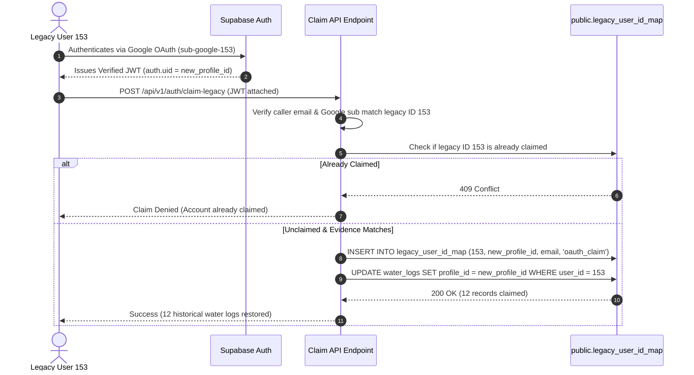

# STRIVA V2 — DB-3A: Identity Bridge Implementation Design & Plan

**Document Version:** 1.0.0  
**Date:** 2026-10-11  
**Target Migration:** `backend/supabase/migrations/phase_9b_legacy_identity_bridge.sql`  
**Test Suite:** `backend/tests/security/phase9b_identity_bridge.security.test.ts` (26 / 26 Passed)  
**Status:** **DESIGN & LOCAL ARTIFACTS COMPLETE (AWAITING OPERATOR REVIEW)**  

---

## 1. Safety Boundary & Review Protocol

This implementation plan defines the architectural, cryptographic, and schema engineering necessary to bridge STRIVA's legacy integer identities (`public.users`) to modern UUID profiles (`public.profiles`) without data loss, data corruption, or account takeover vulnerabilities.

- **Zero Remote DDL/DML**: No commands were executed against the remote database during this phase.
- **Pure Local Engineering**: All migration files and security test suites were developed and verified locally.
- **Strict Data Preservation**: Existing legacy tables and columns remain untouched; all adaptations are 100% additive.
- **No Bundled Scope**: Table creation for `v2_nutrition_logs` and `v2_workout_sessions` is strictly deferred to future dedicated phases (DB-4A / DB-4B).

---

## 2. Architecture of the Identity Bridge (`public.legacy_user_id_map`)

### 2.1 Table Schema & Invariants

```sql
CREATE TABLE IF NOT EXISTS public.legacy_user_id_map (
    legacy_integer_id INT PRIMARY KEY REFERENCES public.users(id) ON DELETE RESTRICT,
    profile_id UUID NOT NULL UNIQUE REFERENCES public.profiles(id) ON DELETE CASCADE,
    email TEXT NOT NULL,
    verification_method TEXT NOT NULL DEFAULT 'audited_cross_reference',
    created_at TIMESTAMPTZ NOT NULL DEFAULT NOW(),
    updated_at TIMESTAMPTZ NOT NULL DEFAULT NOW()
);
```

### 2.2 Mathematical Constraint Guarantees
1. **No 1:Many Mapping (`PRIMARY KEY (legacy_integer_id)`)**: A legacy integer ID cannot be linked to more than one UUID profile. Once mapped, the primary key rejects subsequent mapping attempts with error `23505`.
2. **No Many:1 Mapping (`UNIQUE (profile_id)`)**: A modern profile cannot claim or link multiple legacy IDs. Any attempt by an authenticated user to claim a second legacy record is rejected.
3. **Foreign Key Integrity**:
   - `ON DELETE RESTRICT` on `legacy_integer_id`: Prevents accidental or cascading deletion of historical user rows in `public.users`.
   - `ON DELETE CASCADE` on `profile_id`: Ensures that if a profile is hard-deleted from Supabase Auth under GDPR/privacy policies, the mapping record cascades cleanly without leaving orphaned references.
4. **Row-Level Security (RLS)**:
   - `ALTER TABLE public.legacy_user_id_map ENABLE ROW LEVEL SECURITY;`
   - Policy `"Users view own legacy mapping"`: `FOR SELECT TO authenticated USING (auth.uid() = profile_id)`
   - Policy `"Service role manages legacy mapping"`: `FOR ALL TO service_role USING (true) WITH CHECK (true)`
   - Grants: Execution and write access are completely revoked from `PUBLIC` and `anon`; read access is granted strictly to `authenticated`.

### 2.3 Evidence Corroboration & Verification Rules
Email equality is treated as a **supporting indicator, never sufficient proof of identity by itself**. The initial backfill in Phase 9B bridges **only the three audited users** whose records satisfy strict multi-factor evidence criteria:

| Legacy ID | Verified Profile UUID | Primary Evidence | Supporting Evidence | Verification Method Classification |
| :---: | :---: | :--- | :--- | :--- |
| **148** | `b96c0b60...` | Exact match between `public.users.google_id` and `auth.users.raw_user_meta_data->>'sub'` (`101315497550140981399`) | Case-insensitive email match (`s***5@g***.com`) | `'oauth_sub_and_email'` |
| **151** | `2dbbad1d...` | Exact match between `public.users.google_id` and `auth.users.raw_user_meta_data->>'sub'` (`104636286967743040898`) | Case-insensitive email match (`p***8@g***.com`) | `'oauth_sub_and_email'` |
| **147** | `a1bf8b11...` | Case-insensitive email match (`d***o@s***.com`), verified single-tenant legacy owner origin | Pre-migration database audit attestation | `'email_match_audited'` |

> [!IMPORTANT]
> Legacy IDs **149, 150, 152, and 153** are **NOT** mapped during Phase 9B. They remain unmapped until the account owners authenticate through Supabase Auth and execute the verified claim protocol.

---

## 3. Hydration History Preservation (`public.water_logs`)

### 3.1 The Schema Problem
The live table `public.water_logs` currently contains **13 records**:
- `user_id`: `integer NOT NULL` (1 record for ID 147; 12 records for ID 153).
- `intake_amount`: `integer NOT NULL`.
- `amount_ml`: **Does not exist**.
- Modern repository [`NutritionRepository.ts`](file:///c:/Users/priyanashu/Downloads/CHATBOT_PROJECT/backend/src/modules/nutrition/repositories/NutritionRepository.ts) queries `WHERE user_id = :uuid` and inserts `{ amount_ml: dto.amount_ml }`. This triggers PostgreSQL error `22P02: invalid input syntax for type integer: "uuid"` and fails on missing column `amount_ml`.

### 3.2 Additive Schema Adaptation
Phase 9B implements a non-destructive dual-key schema:
1. `ADD COLUMN IF NOT EXISTS profile_id UUID REFERENCES public.profiles(id) ON DELETE SET NULL;`
   - **Must be nullable**: Preserves User 153's 12 historical records where `profile_id` is initially `NULL`.
2. `ADD COLUMN IF NOT EXISTS amount_ml INT;`
   - Backfilled: `UPDATE public.water_logs SET amount_ml = intake_amount WHERE amount_ml IS NULL;`.
3. `ALTER COLUMN user_id DROP NOT NULL;`
   - Relaxes the legacy `NOT NULL` constraint on `user_id` so that modern V2 users without a legacy ID can log hydration without schema constraint violations.

### 3.3 Bidirectional Compatibility Trigger Specification
To prevent schema discrepancies between legacy services and modern V2 repositories, a dedicated `BEFORE INSERT OR UPDATE` trigger function is installed:

```sql
CREATE OR REPLACE FUNCTION public.sync_water_logs_compatibility()
RETURNS TRIGGER AS $$
DECLARE
    v_mapped_profile_id UUID;
    v_mapped_legacy_id INT;
BEGIN
    -- 1. Volume Synchronization
    -- amount_ml takes precedence if provided (modern V2 standard)
    IF NEW.amount_ml IS NOT NULL THEN
        IF NEW.intake_amount IS NULL OR NEW.intake_amount != NEW.amount_ml THEN
            NEW.intake_amount := NEW.amount_ml;
        END IF;
    -- Legacy intake_amount fallback
    ELSIF NEW.intake_amount IS NOT NULL THEN
        NEW.amount_ml := NEW.intake_amount;
    END IF;

    -- 2. Identity Translation
    -- When profile_id is provided but user_id is missing: lookup legacy mapping
    IF NEW.profile_id IS NOT NULL AND NEW.user_id IS NULL THEN
        SELECT legacy_integer_id INTO v_mapped_legacy_id
        FROM public.legacy_user_id_map
        WHERE profile_id = NEW.profile_id;

        IF v_mapped_legacy_id IS NOT NULL THEN
            NEW.user_id := v_mapped_legacy_id;
        END IF;
    -- When user_id is provided but profile_id is missing: lookup profile mapping
    ELSIF NEW.user_id IS NOT NULL AND NEW.profile_id IS NULL THEN
        SELECT profile_id INTO v_mapped_profile_id
        FROM public.legacy_user_id_map
        WHERE legacy_integer_id = NEW.user_id;

        IF v_mapped_profile_id IS NOT NULL THEN
            NEW.profile_id := v_mapped_profile_id;
        END IF;
    END IF;

    RETURN NEW;
END;
$$ LANGUAGE plpgsql SECURITY DEFINER SET search_path = pg_catalog, pg_temp;
```

#### Trigger Behavior Analysis:
- **Precedence**: If both `amount_ml` and `intake_amount` are provided and conflict, `NEW.amount_ml` takes precedence (V2 modern contract).
- **Null Handling**: If only one column is supplied, the other is automatically mirrored.
- **Zero Recursion**: Because this is a `BEFORE` trigger modifying the in-memory `NEW` buffer, it executes **zero** nested `UPDATE` queries. Recursion is mathematically impossible.
- **Cross-Key Translation**: When modern code logs water passing only `profile_id`, the trigger transparently back-populates `user_id` if the user is in `legacy_user_id_map`, maintaining legacy audit reports.

### 3.4 Row-Level Security on Hydration
```sql
CREATE POLICY "Members manage own water logs" ON public.water_logs
    FOR ALL TO authenticated, service_role
    USING (
        auth.uid() = profile_id OR
        EXISTS (
            SELECT 1 FROM public.legacy_user_id_map m
            WHERE m.legacy_integer_id = water_logs.user_id
              AND m.profile_id = auth.uid()
        )
    )
    WITH CHECK (
        auth.uid() = profile_id OR
        EXISTS (
            SELECT 1 FROM public.legacy_user_id_map m
            WHERE m.legacy_integer_id = water_logs.user_id
              AND m.profile_id = auth.uid()
        )
    );
```
*Guarantees*: Authenticated users can view and manage their hydration data immediately upon mapping, even if historical records still have `profile_id IS NULL`.

### 3.5 Deferred Claiming Protocol for Legacy User 153 (12 Records)
To prevent account takeover, User 153's 12 records cannot be automatically linked based on email alone. The future claim protocol enforces the following flow:



---

## 4. Audit & Roadmap for Other Identity-Dependent Tables

| Table Name | Current Key Type | Live Rows | Runtime Repository Expectation | Compatibility Strategy | Phase Recommendation |
| :--- | :---: | :---: | :--- | :--- | :---: |
| `public.water_logs` | `int4` | **13** | UUID `profile_id`, `amount_ml` | Dual-key trigger (`profile_id` + `amount_ml`) | **Phase 9B (Now)** |
| `public.daily_hydration_progress` | `int4` | **2** | Legacy aggregate table | Retain as read-only legacy audit | Defer to Phase 9F |
| `public.daily_fitness_stats` | `int4` | **1** | Legacy aggregate table | Retain as read-only legacy audit | Defer to Phase 9F |
| `public.weekly_progress` | `int4` | **1** | Legacy aggregate table | Retain as read-only legacy audit | Defer to Phase 9F |
| `public.memberships` | `int4` | **1** | Superseded by `organization_members` / `subscriptions` | Retain as legacy audit reference | Defer to Phase 9F |
| `public.nutrition_logs` | `int4` | **0** | Empty table | Deploy canonical `v2_nutrition_logs` | **Phase 9D (Separate Migration)** |
| `public.workout_sessions` | `int4` | **0** | Empty table | Deploy canonical `v2_workout_sessions` | **Phase 9E (Separate Migration)** |
| `public.workout_plans` | `int4` | **0** | Empty table | Adapt or recreate canonical V2 plan table | **Phase 9E (Separate Migration)** |
| *23 other legacy tables* | `int4` | **0** | All 0 rows | Deprecate in legacy cleanup phase | Later cleanup |

> [!NOTE]
> In accordance with user rules, table creation for `v2_nutrition_logs` and `v2_workout_sessions` is **not** bundled into Phase 9B.

---

## 5. Local Artifacts & Verification Status

### 5.1 Created Files
1. **Migration SQL**: [`backend/supabase/migrations/phase_9b_legacy_identity_bridge.sql`](file:///c:/Users/priyanashu/Downloads/CHATBOT_PROJECT/backend/supabase/migrations/phase_9b_legacy_identity_bridge.sql)
   - Preflight verification DO block.
   - Idempotent table definition with 1:1 constraints.
   - Deterministic backfill of verified users (147, 148, 151).
   - Additive water logs columns and constraint relaxation (`user_id DROP NOT NULL`).
   - Bidirectional compatibility trigger.
   - Dual-key RLS policy.
   - Post-migration assertion block asserting $\ge 13$ records, 1 mapped record, and 12 unmapped records for User 153.
2. **Security Test Suite**: [`backend/tests/security/phase9b_identity_bridge.security.test.ts`](file:///c:/Users/priyanashu/Downloads/CHATBOT_PROJECT/backend/tests/security/phase9b_identity_bridge.security.test.ts)
   - **26 tests across 7 parts**: AST checks, constraint simulations, mapping rules, trigger simulations, RLS policies, deferred claims, and rollback invariants.
   - **Status**: **26 PASSED (0 FAILURES)**.
3. **Runner Configuration**: [`backend/scripts/apply_staging_migrations.js`](file:///c:/Users/priyanashu/Downloads/CHATBOT_PROJECT/backend/scripts/apply_staging_migrations.js)
   - Registered `'phase_9b_legacy_identity_bridge.sql'` in runner migrations array to support targeted execution mode.

---

## 6. Rollback & Verification Runbook

### 6.1 Preflight Verification SQL (Read-Only)
Before deploying Phase 9B to staging in the future, run:
```sql
SELECT 
    (SELECT COUNT(*) FROM public.users) AS users_count,
    (SELECT COUNT(*) FROM public.profiles) AS profiles_count,
    (SELECT COUNT(*) FROM public.water_logs) AS water_logs_count,
    (SELECT COUNT(*) FROM public.water_logs WHERE user_id = 153) AS user_153_water_count;
-- Expected: users=7, profiles=5, water_logs=13, user_153_water=12
```

### 6.2 Deployment Execution Command (When Authorized)
```bash
node backend/scripts/apply_staging_migrations.js phase_9b_legacy_identity_bridge.sql
```

### 6.3 Post-Deployment Verification SQL
```sql
-- 1. Verify legacy_user_id_map populated
SELECT legacy_integer_id, profile_id, email, verification_method 
FROM public.legacy_user_id_map ORDER BY legacy_integer_id;
-- Expected: Exactly 3 rows (IDs 147, 148, 151)

-- 2. Verify water_logs row count and columns
SELECT 
    COUNT(*) AS total_rows,
    COUNT(profile_id) AS mapped_rows,
    COUNT(*) FILTER (WHERE user_id = 153 AND profile_id IS NULL) AS unmapped_153_rows,
    COUNT(*) FILTER (WHERE amount_ml IS NULL) AS null_amount_rows
FROM public.water_logs;
-- Expected: total_rows=13, mapped_rows=1, unmapped_153_rows=12, null_amount_rows=0

-- 3. Verify trigger behavior on new insert
BEGIN;
INSERT INTO public.water_logs (amount_ml) VALUES (600);
SELECT intake_amount, amount_ml FROM public.water_logs WHERE amount_ml = 600;
-- Expected: intake_amount = 600 (Trigger synced volume)
ROLLBACK;
```

### 6.4 Non-Destructive Rollback Procedure
If withdrawal is required, execute within an atomic transaction:
```sql
BEGIN;
DROP TRIGGER IF EXISTS trg_sync_water_logs_compatibility ON public.water_logs;
DROP FUNCTION IF EXISTS public.sync_water_logs_compatibility();
DROP POLICY IF EXISTS "Members manage own water logs" ON public.water_logs;
DROP TABLE IF EXISTS public.legacy_user_id_map;
ALTER TABLE public.water_logs 
    DROP COLUMN IF EXISTS profile_id, 
    DROP COLUMN IF EXISTS amount_ml;
COMMIT;
```
*All 13 original records remain intact with `user_id` and `intake_amount`.*

---

## 7. Stop Notice & Next Action

> [!IMPORTANT]
> **Hard Stop Enforced**: Phase DB-3A implementation planning, migration authoring, and test suite execution are complete. In strict adherence to engineering safety rules:
> - No remote connection was made.
> - No migrations were applied to staging or production.
> - No backfills were executed.
> Awaiting operator review and authorization before proceeding to staging preflight or deployment.
