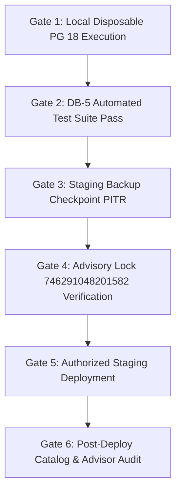

# STRIVA V2 — Phase 11 / DB-5: Pre-Launch Hardening Implementation Plan

**Date:** 2026-10-13  
**Auditor & Implementation Lead:** Antigravity (STRIVA V2 Quality & Security Architecture Gate)  
**Target Reference:** Phase 11 / DB-5 Pre-Launch Hardening Implementation Blueprint  
**Target Staging Project:** `ymrblyiwohvxptiqjfsi`  
**Staging Migration Baseline:** Strictly 25 migrations through Phase 10B  
**Mode:** Planning and Local Preparation Only (Zero DDL, Zero DML, Zero Remote Execution)  
**Target Migration Draft:** [`backend/supabase/migrations/phase_11_prelaunch_hardening.sql`](file:///c:/Users/priyanashu/Downloads/CHATBOT_PROJECT/backend/supabase/migrations/phase_11_prelaunch_hardening.sql)  
**Deliverable Document:** `docs/database/PHASE-11-DB5-implementation-plan.md`  

---

## 1. Executive Summary & Objective

This document establishes the canonical implementation plan for **DB-5 Pre-Launch Security Hardening**. Synthesizing findings from the Phase 11 Readiness Audit, Function Inventory, and Table Usage Audit, this plan defines the exact technical specifications, dependency boundaries, architectural rationales, and authorization models for the three approved pre-launch technical hardening items.

### Strict Safety & Planning Constraints
- **Zero Remote Mutations**: No SQL has been applied to staging (`ymrblyiwohvxptiqjfsi`) or production.
- **Strict 25-Migration Baseline**: Staging baseline remains exactly 25 migrations. The draft migration (`phase_11_prelaunch_hardening.sql`) is stored locally as draft code pending human review and authorization.
- **External Commercial Gating**: B2B gym tier pricing (`gym_starter`, `gym_growth`, `gym_enterprise`) and Goods and Services Tax (GST) invoicing rules are strictly excluded and documented as an external business dependency.
- **No Blanket RLS Policies**: The 41 quarantined legacy and internal backend tables without policies remain strictly deny-by-default.

---

## 2. Approved Implementation Scope & Detailed Rationale

---

### Item A — Tenant Isolation Hardening (`profiles.organization_id`)

#### 1. Exact Change
Execute:
```sql
ALTER TABLE public.profiles 
    ALTER COLUMN organization_id DROP DEFAULT;

UPDATE public.profiles 
SET organization_id = NULL 
WHERE organization_id = '00000000-0000-0000-0000-000000000001'::uuid
  AND id NOT IN (
    SELECT user_id FROM public.organization_members 
    WHERE organization_id = '00000000-0000-0000-0000-000000000001'::uuid
  );
```

#### 2. Architecture Rationale
- **STRIVA Rule 6 Compliance**: AGENTS.md Rule 6 strictly dictates: *"String literals like '00000000-0000-0000-0000-00000001' or fallback tenant UUIDs are strictly PROHIBITED in production code. Unauthenticated or unassigned tenant requests must fail closed (403 Forbidden)."*
- **Default Elimination**: No replacement default is assigned. When a new user signs up via Supabase Auth, `handle_new_user()` inserts `(id, email, full_name, avatar_url)` into `public.profiles`. Without a default, PostgreSQL assigns `organization_id = NULL`.
- **Fail-Closed Authorization Behavior**:
  - In `backend/src/middleware/tenant.middleware.ts`, unassigned members resolving `organizationId = null` are blocked with `HTTP 403 Forbidden` on all tenant-scoped gym operations (`/api/v1/owner/*`, `/api/v1/admin/*`, `/api/v1/attendance/*`).
  - Standard consumer fitness tracking routes (`/api/v1/nutrition/*`, `/api/v1/workouts/*`, `/api/v1/coach/*`) do not evaluate gym tenant context; they scope records strictly to `user_id = auth.uid()` and continue functioning uninterrupted.

---

### Item B — Atomic Demo Account Data Reset Procedure

#### 1. Exact Routine Specification
Deploy `public.reset_demo_account(target_user_id UUID)`:
```sql
CREATE OR REPLACE FUNCTION public.reset_demo_account(target_user_id UUID)
RETURNS void AS $$
DECLARE
    v_demo_email TEXT;
BEGIN
    IF target_user_id IS NULL THEN
        RAISE EXCEPTION 'Target user ID must not be null';
    END IF;

    SELECT email INTO v_demo_email 
    FROM public.profiles 
    WHERE id = target_user_id;

    IF v_demo_email IS NULL THEN
        RAISE EXCEPTION 'Target user profile not found: %', target_user_id;
    END IF;

    IF v_demo_email <> 'demo@sweatfix.com' AND v_demo_email NOT LIKE '%demo%' THEN
        RAISE EXCEPTION 'Security violation: reset_demo_account is restricted strictly to verified demo accounts. Target email: %', v_demo_email;
    END IF;

    -- Child sets deleted before parent workout sessions
    DELETE FROM public.exercise_sets 
    WHERE session_id IN (
        SELECT id FROM public.v2_workout_sessions WHERE user_id = target_user_id
    );

    DELETE FROM public.v2_workout_sessions WHERE user_id = target_user_id;
    DELETE FROM public.v2_workout_plans WHERE user_id = target_user_id;
    DELETE FROM public.v2_nutrition_logs WHERE user_id = target_user_id;
    DELETE FROM public.water_logs WHERE profile_id = target_user_id;

    DELETE FROM public.progress WHERE user_id = target_user_id;
    DELETE FROM public.daily_plans WHERE user_id = target_user_id;
    DELETE FROM public.workout_plans WHERE user_id = target_user_id;
    DELETE FROM public.workout_sessions WHERE user_id = target_user_id;
    DELETE FROM public.chatbot_generated_plans WHERE user_id = target_user_id;
    DELETE FROM public.workout_logs WHERE user_id = target_user_id;
    DELETE FROM public.progress_logs WHERE user_id = target_user_id;
    DELETE FROM public.chatbot_generated_workouts WHERE user_id = target_user_id;
    DELETE FROM public.chatbot_generated_diets WHERE user_id = target_user_id;
    DELETE FROM public.user_fitness_plans WHERE user_id = target_user_id;
    DELETE FROM public.user_meal_tracking WHERE user_id = target_user_id;
    DELETE FROM public.user_progress WHERE user_id = target_user_id;
END;
$$ LANGUAGE plpgsql SECURITY DEFINER SET search_path = pg_catalog, pg_temp;

REVOKE ALL ON FUNCTION public.reset_demo_account(UUID) FROM PUBLIC;
REVOKE ALL ON FUNCTION public.reset_demo_account(UUID) FROM anon;
REVOKE ALL ON FUNCTION public.reset_demo_account(UUID) FROM authenticated;
GRANT EXECUTE ON FUNCTION public.reset_demo_account(UUID) TO service_role;
```

#### 2. Architecture & Authorization Rationale
- **ACID Transaction Atomicity**: Replaces the sequential 18-step PostgREST HTTP loop in `IdentityRepository.resetDemoData()` with a single stored procedure executing inside an atomic PostgreSQL transaction. A mid-operation connection drop or timeout triggers an automatic rollback of 100% of deletions.
- **Strict Scoping & Demo Guarding**: The routine strictly checks that `v_demo_email` matches verified demo credentials (`demo@sweatfix.com` or `%demo%`). Invoking with a legitimate member UUID raises a security exception and aborts.
- **Child-Before-Parent Ordering**: Deletes `exercise_sets` before `v2_workout_sessions`, respecting foreign key constraints without incurring cascading locking overhead.
- **Intentionally Excluded Tables**:
  - `public.profiles`: Must be preserved so the demo user can remain authenticated.
  - `public.subscriptions`: Must be preserved so the permanent sandbox entitlement (`status = 'active'`, `current_period_end = NOW() + 100 years`) remains active.
  - `public.member_settings`: Preserves UI preferences (theme, date formatting).
  - Shared catalogs (`exercises`, `equipment`) and audit ledgers (`payment_events`, `ai_usage_analytics`).
- **PostgREST RPC Lockdown**: Routine execution is revoked from `PUBLIC`, `anon`, and `authenticated`. Untrusted client browsers cannot invoke `/rest/v1/rpc/reset_demo_account`.
- **Application Invocation Path**: Invoked exclusively by the verified backend Express route `/api/v1/identity/demo-reset` via `IdentityRepository.ts` using `supabaseAdmin` (`service_role` key):
  ```typescript
  const { error } = await this.supabase.rpc('reset_demo_account', { target_user_id: userId });
  ```

---

### Item C — Function Search Path & Routine Privilege Hardening

#### 1. Exact Routine Hardening Specifications
1. **`public.handle_new_user()`**:
   - Recreate with `SECURITY DEFINER SET search_path = pg_catalog, pg_temp`.
   - Fully schema-qualify all table inserts (`public.profiles`, `public.v2_fitness_profiles`, `public.user_preferences`, `public.member_settings`, `public.subscriptions`).
   - Routine Grants: Account for Supabase Auth trigger execution context:
     ```sql
     REVOKE ALL ON FUNCTION public.handle_new_user() FROM PUBLIC;
     REVOKE ALL ON FUNCTION public.handle_new_user() FROM anon;
     REVOKE ALL ON FUNCTION public.handle_new_user() FROM authenticated;
     GRANT EXECUTE ON FUNCTION public.handle_new_user() TO supabase_auth_admin, service_role, postgres;
     ```
2. **`public.is_org_member(target_org_id UUID)`**:
   - Recreate with `STABLE SECURITY DEFINER SET search_path = pg_catalog, pg_temp`.
   - Fully schema-qualify `public.organization_members` and `public.organizations`.
   - Routine Grants:
     ```sql
     REVOKE ALL ON FUNCTION public.is_org_member(UUID) FROM PUBLIC;
     REVOKE ALL ON FUNCTION public.is_org_member(UUID) FROM anon;
     GRANT EXECUTE ON FUNCTION public.is_org_member(UUID) TO authenticated;
     GRANT EXECUTE ON FUNCTION public.is_org_member(UUID) TO service_role;
     ```
3. **`public.enforce_workout_session_state_transition()`**:
   - Recreate with `SET search_path = pg_catalog, pg_temp`.
   - Routine Grants: Retain standard trigger execution (`GRANT EXECUTE TO authenticated, service_role`).

#### 2. Architecture Rationale
- **Search Path Hijacking Defense**: Setting `search_path = pg_catalog, pg_temp` prevents malicious users who create objects in `public` from shadowing system operators or functions during routine execution under `postgres` superuser privileges.
- **Signature & Call Site Invariance**: Because signatures remain 100% identical (`handle_new_user()` returns trigger; `is_org_member(UUID)` returns boolean; `enforce_workout_session_state_transition()` returns trigger), existing triggers and the 11 dependent RLS policies do not require recreation.
- **Routines Left Unmodified**: `public.is_org_manager(UUID)` (Phase 9A) and `public.sync_water_logs_compatibility()` (Phase 9B) are verified already hardened with `pg_catalog, pg_temp` and restricted routine grants.

---

## 3. Reconciliation of 41-versus-42 RLS-Enabled Tables Without Policies

A specific investigation reconciled the discrepancy between historical audit notes reporting 42 tables versus current catalog inventories reporting 41 tables with RLS enabled and zero policies:

1. **Pre-Phase 9B Snapshot Baseline (`audit_results.json`)**:
   - Exactly **94 tables** existed in `public` schema.
   - Exactly **52 public tables** had RLS policies defined (an additional 2 tables with policies were in schema `cron`: `cron.job` and `cron.job_run_details`, totaling 54 policies).
   - In that snapshot, 94 public tables - 52 public tables with policies = **42 public tables without policies**.
   - One of those 42 tables was `public.water_logs`.
2. **Phase 9B Deployment Effect (`phase_9b_legacy_identity_bridge.sql`)**:
   - Phase 9B explicitly applied Row Level Security policies to `public.water_logs`:
     - `"Members manage own water logs"` (`FOR ALL TO authenticated`)
     - `"Service role manages water logs"` (`FOR ALL TO service_role`)
   - Phase 9B also introduced `public.legacy_user_id_map` with 2 policies (`"Users view own legacy mapping"`, `"Service role manages legacy mapping"`).
3. **Current Live Staging Baseline (Phase 10B)**:
   - Because `water_logs` now possesses policies, the count of public tables with RLS enabled and zero policies dropped from 42 to **exactly 41**.
4. **Classification & Policy Posture**:
   - Of these 41 tables:
     * **5 tables** are internal backend ledgers (`_migrations`, `payment_events`, `organization_staff`, `session`, `push_subscriptions`). Deny-by-default is **mandatory**.
     * **36 tables** are quarantined legacy V1 schemas (`users`, legacy `workout_sessions`, etc.). Deny-by-default is **mandatory**.
   - **Conclusion**: The discrepancy is 100% reconciled by the Phase 9B deployment. Zero tables require blanket policies.

---

## 4. Verification Gates & Execution Prerequisites

Before `phase_11_prelaunch_hardening.sql` may be applied to staging, the following gates must be completed in order:



### Gate 1: Local Disposable PostgreSQL 18.3 Verification
- Apply `phase_11_prelaunch_hardening.sql` against the local isolated cluster on `127.0.0.1:5433`.
- Verify execution succeeds within transaction block without warnings.
- Introspect `information_schema.columns` to verify `profiles.organization_id.default IS NULL`.
- Introspect `pg_proc` to verify `is_org_member`, `handle_new_user`, and `enforce_workout_session_state_transition` reflect `["search_path=pg_catalog, pg_temp"]`.

### Gate 2: Local Integration & Regression Suites Pass
- Execute the DB-5 test suite (see [`PHASE-11-DB5-test-and-rollback-plan.md`](file:///c:/Users/priyanashu/Downloads/CHATBOT_PROJECT/docs/database/PHASE-11-DB5-test-and-rollback-plan.md)).
- Re-execute all 91 baseline tests (22 real PostgreSQL tests, 40 unit/regression tests, 29 security/isolation tests).
- Assert 100% pass rate with zero regressions.

### Gate 3: Staging Pre-Migration Backup Checkpoint
- Before connecting to staging (`ymrblyiwohvxptiqjfsi`), confirm active Point-In-Time-Recovery (PITR) physical backup on the Supabase project.
- A logical DML snapshot or export script alone is **not** sufficient for DDL rollback.

### Gate 4: Concurrency Advisory Lock Enforcement
- Verify that `backend/scripts/apply_staging_migrations.js` acquires 64-bit advisory lock `746291048201582` before inspecting migration state.

---

## 5. Commercial Gating (B2B Pricing & GST Rules)

- **Finding**: Canonical B2B subscription plans (`gym_starter`, `gym_growth`, `gym_enterprise`) operate with `amount_paise = NULL` and `is_configured = false`. Goods and Services Tax (GST) registration numbers and invoicing rules remain unapproved.
- **Architectural Boundary**: DB-5 is strictly a technical security and database hardening migration.
- **Directive**: B2B pricing and GST rules remain an **external launch gate**. DB-5 must not invent pricing numbers or declare commercial billing ready until formal written stakeholder sign-off is provided.

---

*Plan complete. In strict adherence to safety constraints, zero remote database writes, migration applications, or production mutations occurred.*
