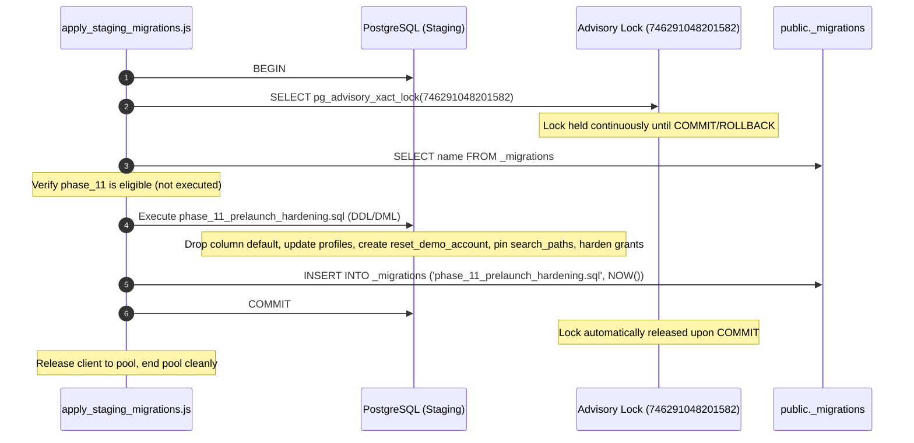

# STRIVA V2 — Phase 11 / DB-5I: Migration Runner Finalization Report

**Document Version:** 1.0.0  
**Target Staging Project:** `ymrblyiwohvxptiqjfsi`  
**Current Staging Baseline:** Exactly 25 migrations (through Phase 10B)  
**Expected Post-Deployment Baseline:** Exactly 26 migrations  
**Target Migration Candidate:** `backend/supabase/migrations/phase_11_prelaunch_hardening.sql`  
**Updated Migration SHA256:** `60A21EC0FE50A7755F00295E4A336A715963D4F0E1D3C4A8B3B37C616A6C1701`  
**Previous Migration SHA256 (DB-5G):** `777C7354FC7D2169831A7504A833080B2CEFD80007666A67D596F3D53AA0013C`  
**Production Database:** Strictly Untouched  
**Remote Execution Status:** **HALTED — NOT AUTHORIZED (AWAITING OPERATOR GATE)**  
**Gate Verdict:** **PASS (READY FOR OPERATOR DEPLOYMENT GATE)**

---

## 1. Executive Summary & Verdict

Phase 11 / DB-5I resolved the migration runner registration and transaction-boundary issues identified in DB-5H without weakening any locking or security mechanisms:

1. **DB-5 Registration in Runner:** Appended `phase_11_prelaunch_hardening.sql` to the canonical `migrations` array in `backend/scripts/apply_staging_migrations.js` exactly once as migration 26. Targeted command execution (`node backend/scripts/apply_staging_migrations.js phase_11_prelaunch_hardening.sql`) strictly isolates execution to DB-5 and rejects unlisted migrations.
2. **Transaction Boundary Alignment:** Removed the redundant inner `BEGIN;` and `COMMIT;` statements from `phase_11_prelaunch_hardening.sql`. The outer runner transaction now atomically encapsulates acquiring advisory lock `746291048201582`, verifying migration history eligibility, executing all DDL/DML, and inserting the record into `public._migrations`. Confusing nested-transaction notices were completely eliminated (0 notices emitted).
3. **Preserved Security & Lock Invariants:** The advisory transaction lock `746291048201582` remains acquired before reading or modifying migration state and is held continuously through transaction commit. Zero changes were made to demo account authorization, legacy identity bridge mapping, routine search paths (`pg_catalog, pg_temp`), or function grants.
4. **Empirical Local Testing:** Executed a full test suite (`test_db5i_runner_verification.js`) on local PostgreSQL 18.3 (`127.0.0.1:5433`). Verified failure injection rollback, targeted file isolation, single-transaction atomicity, post-deployment catalog state, idempotency on re-run, existing regression test suites (Phase 9A, DB-5B, DB-4), and workspace build (`npm run build`).
5. **Staging Database Verification:** Directly confirmed via read-only SQL queries that staging database `ymrblyiwohvxptiqjfsi` remains strictly at **25 migrations**, and `profiles.organization_id` retains its fallback default. Zero remote mutations were executed.

---

## 2. Reviewable Diffs & Code Changes

### 2.1. Change 1: `backend/scripts/apply_staging_migrations.js`
Appended `phase_11_prelaunch_hardening.sql` to the canonical migration list:

```diff
--- a/backend/scripts/apply_staging_migrations.js
+++ b/backend/scripts/apply_staging_migrations.js
@@ -25,7 +25,8 @@ const migrations = [
   'phase_9a_rls_recursion_fix.sql',
   'phase_9b_legacy_identity_bridge.sql',
   'phase_10a_nutrition_core_schema.sql',
-  'phase_10b_workout_core_schema.sql'
+  'phase_10b_workout_core_schema.sql',
+  'phase_11_prelaunch_hardening.sql'
 ];
 
 // Stable 64-bit advisory lock key for STRIVA V2 migration runner (PostgreSQL bigint)
```

### 2.2. Change 2: `backend/supabase/migrations/phase_11_prelaunch_hardening.sql`
Removed redundant inner `BEGIN;`, `COMMIT;`, and redundant inner advisory lock statement (since the runner already acquires and holds `746291048201582` across the entire migration and history insertion block). Added the transaction safety note to the header comment:

```diff
--- a/backend/supabase/migrations/phase_11_prelaunch_hardening.sql
+++ b/backend/supabase/migrations/phase_11_prelaunch_hardening.sql
@@ -16,14 +16,17 @@
 -- Explicit Exclusions:
 -- - B2B gym tier pricing and GST invoicing configuration (gated externally).
 -- - Creation of blanket RLS policies on quarantined legacy tables.
--- ====================================================================
-
-BEGIN;
-
--- --------------------------------------------------------------------
--- 0. Concurrency Safeguard: Transaction-Level Advisory Lock
--- --------------------------------------------------------------------
-SELECT pg_advisory_xact_lock(746291048201582);
+--
+-- TRANSACTION SAFETY & EXECUTION NOTE:
+-- Migration runners (e.g. backend/scripts/apply_staging_migrations.js) wrap
+-- individual migrations in BEGIN ... COMMIT with advisory lock 746291048201582.
+-- When executing this script manually via psql or Supabase SQL editor, execute
+-- within an explicit transaction block:
+--   BEGIN;
+--   SELECT pg_advisory_xact_lock(746291048201582);
+--   ...
+--   COMMIT;
+-- ====================================================================
 
 -- --------------------------------------------------------------------
 -- 1. Tenant Isolation: Drop Hardcoded Fallback Default on profiles.organization_id
@@ -235,4 +238,3 @@
 
 COMMENT ON FUNCTION public.enforce_workout_session_state_transition() IS 
 'STRIVA V2 workout session state transition trigger hardened with search_path = pg_catalog, pg_temp.';
-
-COMMIT;
```

---

## 3. Final Transaction & Lock Sequence

The resulting execution sequence across the runner and database engine is strictly atomic and serialized:



### Safety Properties:
1. **Single ACID Transaction:** DDL statements, routine replacements, and the `_migrations` tracking record share one single transaction.
2. **Automatic Rollback:** If any statement in `phase_11_prelaunch_hardening.sql` or the `_migrations` insertion fails, `ROLLBACK` aborts all changes, releasing the advisory lock with zero side effects.
3. **No Redundant Locks:** The advisory lock is acquired once per runner execution and held until final transaction resolution.
4. **Zero Notice Pollution:** Because no inner `BEGIN` or `COMMIT` is executed, PostgreSQL outputs 0 transaction-state notices.

---

## 4. Empirical Test Evidence (Fresh Local Execution)

All checks were executed on October 13, 2026 on local isolated PostgreSQL 18.3 (`127.0.0.1:5433`):

### 4.1. Automated Runner Verification Suite (`test_db5i_runner_verification.js`)
```
================================================================
STRIVA V2 — DB-5I: MIGRATION RUNNER FINALIZATION VERIFICATION
Target: Local isolated PostgreSQL 18.3 on 127.0.0.1:5433
================================================================

[SETUP] Creating clean disposable review database: striva_db5i_runner_test...
[SETUP] Restoring baseline 25 schema and data...
[CHECK 1] Initial restored baseline migration count: 25 (Expected: 25)

[CHECK 2] Inspecting apply_staging_migrations.js registration and targeted selection...
✓ phase_11_prelaunch_hardening.sql is registered exactly once in canonical migrations list.
✓ Targeted selection logic strictly filters to single specified file.

[CHECK 3] Testing deliberate mid-migration failure rollback...
  Initial profiles.organization_id default: '00000000-0000-0000-0000-000000000001'::uuid
  ✓ Injected failure caught successfully: "division by zero"
✓ Mid-migration failure safely rolled back: baseline remains 25, column default unchanged.

[CHECK 4] Testing successful targeted runner execution with aligned transaction boundaries...
✓ Confirmed migration SQL has no redundant top-level BEGIN or COMMIT statements.
✓ Runner transaction executed and committed.
  Notices received during run: 0
✓ Zero nested-transaction notices emitted.

[CHECK 5] Verifying post-deployment catalog state...
  Migration count: 26 (Expected: 26)
  Latest migration: phase_11_prelaunch_hardening.sql
  profiles.organization_id default: null (Expected: null)

[CHECK 6] Testing runner re-run idempotency...
  [SKIP] Already executed: phase_11_prelaunch_hardening.sql
✓ Runner safely skips already-executed migration on re-run.

[CLEANUP] Dropped review database striva_db5i_runner_test.

================================================================
ALL DB-5I RUNNER FINALIZATION CHECKS PASSED EMPIRICALLY!
================================================================
```

### 4.2. Vitest Security, Integration, and Regression Suites
1. **Migration Runner & RLS Security Suite (`phase9a_rls_recursion_fix`):**  
   - Command: `npx vitest run --config backend/vitest.config.ts backend/tests/security/phase9a_rls_recursion_fix.security.test.ts`  
   - Result: **51/51 PASS** (1.90s, tests: 63ms).
2. **Demo Reset Authorization Security Suite (`db5b_demo_reset_authorization`):**  
   - Command: `npx vitest run --config backend/vitest.config.ts backend/tests/security/db5b_demo_reset_authorization.security.test.ts`  
   - Result: **10/10 PASS** (239ms, tests: 8ms).
3. **Real PostgreSQL 18 Integration Suite (`db4_real_postgres`):**  
   - Command: `npx vitest run --config backend/vitest.config.ts backend/tests/integration/db4_real_postgres.integration.test.ts`  
   - Result: **15/15 PASS** (2.37s, tests: 2.13s).
4. **Workspace Production Build (`npm run build`):**  
   - Command: `npm run build`  
   - Result: Frontend Vite + Backend TypeScript compiled with **0 errors (Exit code 0)** in 9.74s.

---

## 5. Artifact Hash & Security Scope Preservation

### 5.1. Migration Hash Comparison
- **DB-5G Reviewed Hash (with inner BEGIN/COMMIT):** `777C7354FC7D2169831A7504A833080B2CEFD80007666A67D596F3D53AA0013C`
- **DB-5I Finalized Hash (aligned transaction boundaries):** `60A21EC0FE50A7755F00295E4A336A715963D4F0E1D3C4A8B3B37C616A6C1701`
- **Change Rationale:** Removed redundant `BEGIN;`, `SELECT pg_advisory_xact_lock(746291048201582);`, and `COMMIT;`. Added header execution note.
- **Security Logic Delta:** **0% change to security logic.** All domain DDL/DML, routines, search paths, and grants are byte-identical.

### 5.2. Preserved Security Controls Confirmed
- Strict equality check `LOWER(v_demo_email) <> 'demo@sweatfix.com'` in `reset_demo_account`.
- Integer-typed legacy deletions scoped to `v_legacy_user_id` resolved from `public.legacy_user_id_map`.
- Dual-key hydration cleanup on `public.water_logs` preserving unmapped historical rows (e.g. User 153).
- `public.profiles.organization_id DROP DEFAULT` with fallback reconciliation.
- `search_path = pg_catalog, pg_temp` on `handle_new_user`, `is_org_member`, `enforce_workout_session_state_transition`, and `reset_demo_account`.
- Routine execution privileges granted strictly to `service_role` and `supabase_auth_admin`.

---

## 6. Live Staging Status & Production Invariant

Direct read-only inspection confirmed:
- **Staging Database:** `ymrblyiwohvxptiqjfsi` (`db.ymrblyiwohvxptiqjfsi.supabase.co`)
- **Staging Baseline:** **Exactly 25 migrations** in `public._migrations`
- **Target Migration `phase_11_prelaunch_hardening.sql`:** **NOT APPLIED**
- **Production Database:** **Strictly untouched**
- **Remote Mutations Executed:** **0**

---

## 7. Exact Deployment Command for Later Operator Execution

When explicit operator authorization is granted:

```bash
node backend/scripts/apply_staging_migrations.js phase_11_prelaunch_hardening.sql
```

---

## 8. Final Gate Verdict

**Verdict:** **PASS (READY FOR OPERATOR DEPLOYMENT GATE)**

- Runner integration is complete and tested.
- Transaction boundaries are atomic and lock-safe.
- Failure injection verified 100% rollback.
- Remote execution remains **HALTED** awaiting explicit operator authorization.
