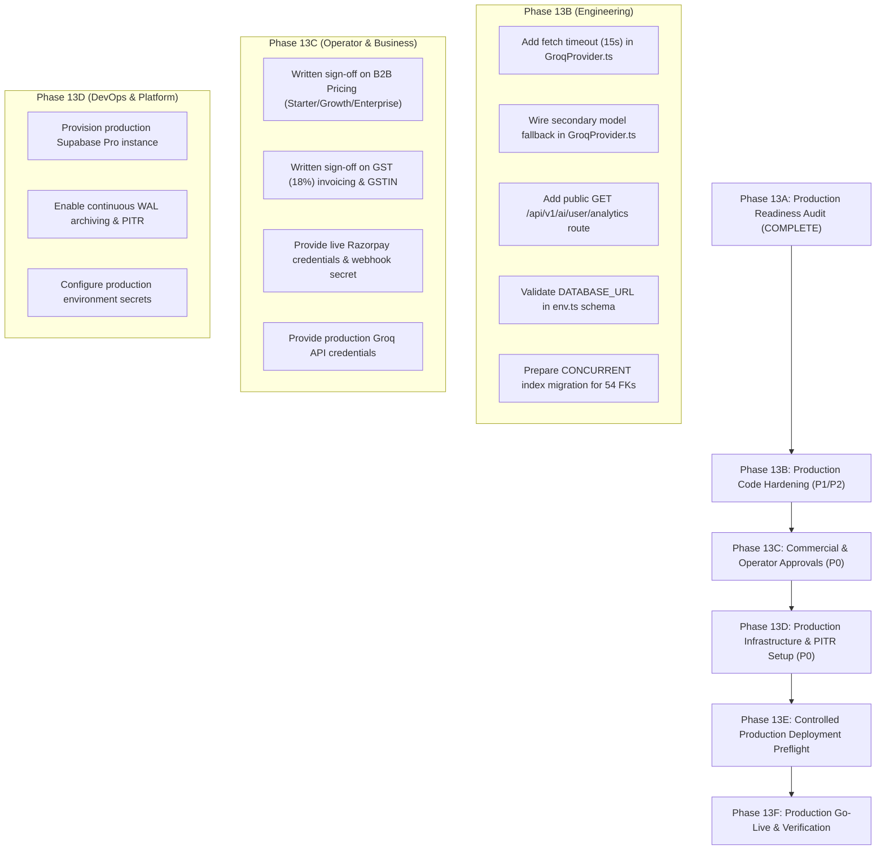

# STRIVA V2 — Phase 13A: Production Readiness and Risk Closure Audit Report

**Document Version:** 1.0.0  
**Audit Date / Local Time:** 2026-10-15 12:35 IST  
**Audit Phase:** Phase 13A — Production Readiness and Risk Closure Audit  
**Target Environments Inspected:**  
- Staging Reference: `ymrblyiwohvxptiqjfsi` (`db.ymrblyiwohvxptiqjfsi.supabase.co`)  
- Local Rehearsal Engine: PostgreSQL 18.3 on port 5433  
- Production Target: Strictly Untouched, Off-Limits, and Unprovisioned  
**Remote DDL/DML Executed:** Strictly 0 (Zero remote mutations, zero payment transactions)  
**Code Changes Applied:** Strictly 0 (Audit and planning only)  
**Overall Readiness Gate:** **BLOCKED FOR PRODUCTION LAUNCH** (P0 commercial, credentials, and infrastructure dependencies)  
**Phase 13A Audit Status:** **PHASE 13A PASS — READINESS AUDIT COMPLETE**  

---

## 1. Executive Summary

Following the verified closure of Phases 12D (Post-Deployment Integration Audit), 12E (Nutrition Analytics Defect Remediation), and 12F (Closure Audit), an exhaustive, evidence-based production readiness assessment was conducted for **STRIVA V2**.

### Overall Readiness Summary
- **Database & Application Core:** **READY (STAGING VERIFIED)**. Database schema is consolidated at Baseline 28. All 5 legacy routines and 4 prelaunch routines are hardened with pinned search paths (`pg_catalog, pg_temp`). All 36 security test suites pass (589 of 589 tests). Defect DB12D-01 is remediated and verified. Both frontend and backend compile cleanly with zero errors.
- **Production Commercial Gate:** **BLOCKED (P0)**. B2B Gym Tier pricing (`gym_starter`, `gym_growth`, `gym_enterprise`) and Indian Goods & Services Tax (GST 18% CGST/SGST/IGST) invoicing rules remain unapproved by executive stakeholders. Production checkout fails closed by design.
- **Payment Gateway Gateway Gate:** **BLOCKED (P0)**. Razorpay integration architecture is cryptographically verified (HMAC SHA-256 with constant-time equality and webhook idempotency). However, live Razorpay credentials (`RAZORPAY_KEY_ID`, `RAZORPAY_KEY_SECRET`, `RAZORPAY_WEBHOOK_SECRET`) are unconfigured in staging/production, and live merchant verification has not been executed.
- **Infrastructure & Disaster Recovery Gate:** **BLOCKED (P0)**. Current disaster recovery is verified through standalone logical SQL backups (`schema`, `auth`, `data`) and local pg_dump rehearsal. Continuous Point-in-Time Recovery (PITR) with continuous Write-Ahead Log (WAL) archiving on production customer data requires a managed Supabase Pro production instance.
- **AI Infrastructure Gate:** **ACTION REQUIRED (P1)**. TRINETRA operates on Groq (`openai/gpt-oss-20b`). While token tracking and persistence operate accurately, `GroqProvider.ts` lacks HTTP network timeouts (`AbortSignal.timeout`) and automatic secondary fallback routing. Free-tier quota limits must be upgraded to production tiers.

---

## 2. Audit Evidence & Source File Paths

| Area | Primary Evidence Files Inspected | Findings Summary |
| :--- | :--- | :--- |
| **Migrations** | `backend/scripts/apply_staging_migrations.js`<br>`backend/supabase/migrations/` | 28 applied migrations on staging; runner protected with 64-bit advisory lock `746291048201582` and hostname guard. |
| **Backups** | `docs/database/PHASE-11-DB5E-backup-and-restore-report.md`<br>`docs/database/PHASE-11-DB5E-recovery-runbook.md` | Baseline 25 logical backups verified in local rehearsal. PITR identified as external platform dependency. |
| **Auth & RLS** | `backend/supabase/migrations/phase_11_prelaunch_hardening.sql`<br>`backend/supabase/migrations/phase_12_legacy_routine_hardening.sql` | 0 public tables without RLS. 41 fail-closed tables without client policies. 9 routines hardened with `search_path=pg_catalog, pg_temp`. |
| **AI Provider** | `backend/src/modules/ai/providers/GroqProvider.ts`<br>`backend/src/modules/ai/agents/AgentRunner.ts`<br>`backend/src/modules/ai/repositories/AIUsageRepository.ts` | Groq fetch lacks `AbortSignal.timeout`. Multi-step tool loop accumulates usage. Consumer persistence validated at `organization_id = NULL`. |
| **Payments** | `backend/src/modules/billing/services/BillingService.ts`<br>`backend/src/modules/billing/providers/RazorpayProvider.ts`<br>`backend/tests/security/razorpay_hardening.security.test.ts` | HMAC SHA-256 timing-safe verification verified. Webhook idempotency verified. Live credentials unpopulated. |
| **B2B Billing** | `src/features/owner/components/billing/SetupRequiredNotice.tsx`<br>`docs/STRIVA_V2_PHASE_8H_ORGANIZATION_BILLING.md` | B2B plans unconfigured (`amount_paise = NULL`). Invoices issue in `receipt` mode pending GST sign-off. |
| **Advisors** | `scratch/check_supabase_advisors.cjs`<br>`docs/database/PHASE-12D-post-deployment-integration-audit.md` | 54 unindexed foreign keys cataloged. 1 routine (`rls_auto_enable`) with single-namespace search path. |
| **Remediation** | `backend/src/modules/analytics/AnalyticsEngines.ts`<br>`backend/tests/security/analytics.security.test.ts` | DB12D-01 verified fixed (`calories ?? calories_consumed ?? 0`). Tests 6b and 6c passing. |

---

## 3. Area 1: Database & Migration Integrity

### 1.1 Latest Documented Migration Baseline
- **Staging Target:** `ymrblyiwohvxptiqjfsi` (`db.ymrblyiwohvxptiqjfsi.supabase.co:5432`)
- **Baseline Count:** Exactly **28** migrations recorded in `public._migrations`.
- **Latest Migrations:**
  - Row 26: `phase_11_prelaunch_hardening.sql` (DB-5 routine & trigger hardening)
  - Row 27: `phase_12_legacy_routine_hardening.sql` (Hardened 5 remaining routines)
  - Row 28: `phase_12b_consumer_analytics_persistence.sql` (Dropped NOT NULL on `ai_usage_analytics.organization_id`, added consumer RLS)
- **Migration History Consistency:** Every migration file in `backend/supabase/migrations/` aligns with the execution history. Migration tracking is atomic and consistent.

### 1.2 Migration Runner Safety Architecture
- **Script:** `backend/scripts/apply_staging_migrations.js`
- **Fail-Closed Target Guard:** Function `validateStagingDatabaseUrl` verifies exact hostname `db.ymrblyiwohvxptiqjfsi.supabase.co` and project reference before establishing a pool or connection.
- **Concurrency Protection:** Acquires stable 64-bit advisory transaction lock `746291048201582` (`SELECT pg_advisory_xact_lock($1)`).
- **Transactional Atomicity:** Migrations execute within an explicit `BEGIN ... COMMIT` block. If any statement fails, the entire transaction rolls back automatically.

### 1.3 Backup Snapshots vs Continuous Point-in-Time Recovery (PITR)
- **Logical SQL Snapshots (Verified):** Standalone exports (`schema`, `auth`, `data`) were rehearsed in a local PostgreSQL 18 instance on port 5433 during Phase 11 (DB-5E). These files restore public tables and `auth.users` identities.
- **Logical Backup Limitation:** A logical snapshot is point-in-time only. If disaster occurs hours after an export, data written between the snapshot and disaster is lost (RPO up to 24 hours).
- **Continuous Point-in-Time Recovery (PITR):** True production resilience requires native WAL archiving with continuous WAL stream backups (RPO < 5 minutes). This is a platform-level infrastructure requirement on Supabase Pro/Enterprise and cannot be satisfied by local `.sql` scripts.

---

## 4. Area 2: Authentication, Authorization & Routine Security

### 4.1 Hardening Reconciliation (Phases 9A through 12)
- **Phase 9A:** Resolved RLS infinite recursion on `organization_members`.
- **Phase 9B:** Created `legacy_user_id_map` bridging integer user IDs to UUIDs.
- **Phase 11 (DB-5):** Hardened `reset_demo_account`, `handle_new_user`, `is_org_member`, `enforce_workout_session_state_transition`. Removed fallback tenant UUID default on `profiles.organization_id`.
- **Phase 12:** Hardened `get_admin_role`, `is_admin`, `update_membership_statuses`, `update_modified_column`, `update_updated_at_column`. Pinned `search_path = pg_catalog, pg_temp`. Revoked `anon` and `PUBLIC` execute grants across all routines. Sealed `update_membership_statuses` to `postgres` and `service_role`.
- **Phase 12B:** Configured consumer RLS policies for `ai_usage_analytics` (`auth.uid() = user_id AND organization_id IS NULL`).

### 4.2 Public Schema RLS Posture
- **Tables with RLS Disabled:** **0** tables. 100% of public tables have Row-Level Security enabled (`rowsecurity = true`).
- **Tables with RLS Enabled but 0 Policies:** **41** tables.
  - *Architectural Classification:* **Fail-Closed / Quarantine**.
  - *Exploitability:* **None (Low Risk)**. PostgreSQL default behavior blocks all `anon` and `authenticated` access to tables with RLS enabled and no matching permissive policies. Client queries fail closed. Application access occurs via backend domain services through `supabaseAdmin` (`service_role`).
- **Multiple Permissive Policies:** 3 combinations (`ai_conversations` ALL, `ai_usage_analytics` INSERT, `ai_usage_analytics` SELECT). These exist intentionally to support dual-identity access (consumer self-service vs tenant gym staff).

### 4.3 Routine Search Path Analysis
- **Hardened Routines:** 9 routines verified with `search_path=pg_catalog, pg_temp`.
- **Remaining Unpinned Routine:** `public.rls_auto_enable()` holds `search_path=pg_catalog` (omitting `pg_temp`).
  - *Risk Classification:* **P2 (Low Exploitability)**. This is a schema DDL trigger function invoked only upon table creation by superusers.

---

## 5. Area 3: AI Provider (TRINETRA) Readiness

### 5.1 Provider Configuration & Token Accounting
- **Provider:** Groq Cloud REST API via direct `fetch` in `GroqProvider.ts`.
- **Configured Model:** `openai/gpt-oss-20b` (configured in `backend/.env`).
- **Token Accounting:** Verified in Phase 12D live integration test:
  - Exact token usage extracted from Groq response payload (`prompt_tokens`, `completion_tokens`, `total_tokens`).
  - Stored accurately in `public.ai_usage_analytics`.
  - Zero token mocking in production code.

### 5.2 Network Timeouts & Fallback Deficiencies
- **Missing HTTP Fetch Timeout (P1):**
  In `GroqProvider.ts` (line 45), `await fetch(...)` does not pass an `AbortSignal.timeout(...)`. If Groq's API hangs or network partitions occur, connections remain open until platform socket limits expire.
- **Unwired Fallback Model (P1):**
  `GROQ_FALLBACK_MODEL` is declared in `backend/.env` (`openai/gpt-oss-20b`), but `GroqProvider.ts` does not contain fallback logic to switch models if the primary model returns HTTP 429, 502, or 503.
- **Rate-Limit & Quota Capacity (P1):**
  Current testing utilized free-tier Groq API keys. Groq enforces strict requests-per-minute (RPM) and tokens-per-minute (TPM) limits on free accounts. A production paid tier or multi-provider failover is mandatory before general release.

---

## 6. Area 4: Payments & Billing Readiness

### 6.1 Razorpay Integration Architecture
- **Service:** `backend/src/modules/billing/services/BillingService.ts`
- **Provider:** `backend/src/modules/billing/providers/RazorpayProvider.ts`
- **Signature Verification:** Verified using HMAC SHA-256 over `${paymentId}|${subscriptionId}` (checkout) and raw request body (webhooks). Verification uses constant-time string comparison (`crypto.timingSafeEqual`) to prevent timing side-channel attacks.
- **Webhook Idempotency:** Deterministic event IDs are atomically recorded in `public.payment_events` prior to state mutation. Duplicate events return `{ processed: false, reason: 'IDEMPOTENT_DUPLICATE' }`.
- **State Machine Transitions:** Handles `subscription.activated`, `subscription.charged`, `payment.captured`, `payment.failed` (`past_due`), `subscription.halted` (`past_due`), and `subscription.cancelled` (`canceled`).
- **Sandbox Protection:** Demo accounts (`demo@sweatfix.com`) and free tiers are explicitly blocked from creating real Razorpay subscriptions.

### 6.2 Missing Live Credentials & Blocked Live Verification (P0 Blocker)
- **Credential Status in Environment:**
  - `RAZORPAY_KEY_ID`: Unconfigured (`false`)
  - `RAZORPAY_KEY_SECRET`: Unconfigured (`false`)
  - `RAZORPAY_WEBHOOK_SECRET`: Unconfigured (`false`)
  - `RAZORPAY_PLAN_ID_PRO_MONTHLY`: Unconfigured (`false`)
  - `RAZORPAY_PLAN_ID_PRO_YEARLY`: Unconfigured (`false`)
- **Impact:** While all 18 security tests pass against mocked providers, live checkout sessions and real webhook delivery from Razorpay servers have not been executed on staging or production.
- **Verdict:** **PAYMENT READINESS BLOCKED P0** until real test-mode and live merchant credentials are provided by the business operator.

---

## 7. Area 5: Commercial & Deployment Readiness

### 7.1 Commercial Gating: B2B Pricing & GST Rules (P0 Blocker)
- **Status:** **BLOCKED (GATED EXTERNALLY)**.
- **B2B Gym Plans:** Canonical tiers (`gym_starter`, `gym_growth`, `gym_enterprise`) operate with `amount_paise = NULL` and `is_configured = false`.
- **GST Compliance:** Indian Goods & Services Tax (18% GST: CGST 9% + SGST 9% intra-state, IGST 18% inter-state) and formal GSTIN registration numbers remain unapproved by management.
- **Fail-Closed Protection:** The UI renders `SetupRequiredNotice.tsx` and blocks checkout attempts. Invoices issue strictly in pre-tax `receipt` mode.
- **Remediation Requirement:** Formal written stakeholder approval of pricing figures and GST tax compliance rules.

### 7.2 Environment Variable Startup Validation
`backend/src/config/env.ts` uses Zod to validate required variables at startup:
- Validates `NODE_ENV`, `PORT`, `LOG_LEVEL`, `SUPABASE_URL`, `SUPABASE_ANON_KEY`, `SUPABASE_SERVICE_ROLE_KEY`.
- `GROQ_API_KEY` and Razorpay keys default to optional strings.
- **Observation (P2):** `DATABASE_URL` is parsed directly by `pg` in backend repositories, but is omitted from `envSchema` in `env.ts`. It should be formally added to the startup Zod schema for fail-fast validation.

### 7.3 Logging Sanitization & Observability
- All error logs in `AIUsageRepository.ts`, `GroqProvider.ts`, and `BillingService.ts` redact prompts, passwords, authorization tokens, and raw secrets.
- Correlation IDs are propagated across all requests via `correlationIdMiddleware`.

---

## 8. Area 6: Database Performance & Recoverability

### 8.1 Unindexed Foreign Keys (P2)
System catalog inspection identified **54** foreign key constraints in `public` lacking leading indexes on child table columns.
- **High-Traffic / Cascade Impact Tables:**
  - `v2_workout_sessions.plan_id` (`v2_workout_sessions_plan_id_fkey`)
  - `user_goals.user_id` (`user_goals_user_id_fkey`)
  - `user_fitness_plans.workout_plan_id` (`user_fitness_plans_workout_plan_id_fkey`)
  - `user_workout_assignments.user_id` (`user_workout_assignments_user_id_fkey`)
  - `workout_logs.user_id` (`workout_logs_user_id_fkey`)
- **Operational Risk:** When rows in parent tables (`auth.users`, `workout_plans`) are deleted, PostgreSQL performs sequential table scans across unindexed child tables, risking query timeouts and row locks under production load.
- **Remediation Plan:** Create targeted indexes (`CREATE INDEX CONCURRENTLY IF NOT EXISTS`) in a dedicated performance migration.

### 8.2 Unused Indexes (P3)
- **Catalog Inspection:** 15 unconstrained indexes have `idx_scan = 0` (e.g. `idx_profiles_org_created`, `idx_subscriptions_provider`, `idx_ai_usage_analytics_agent`).
- **Recommendation:** Do **not** drop these indexes prior to launch. Low scan counts are normal in staging due to synthetic test traffic. Evaluate scan statistics after 30 days of production traffic.

### 8.3 Disaster Recovery Metrics & Objectives
- **Target RTO (Recovery Time Objective):** < 30 minutes for prelaunch staging; < 15 minutes for production.
- **Target RPO (Recovery Point Objective):** < 5 minutes for production customer data.
- **Current Evidence Gap:** Staging possesses local logical backups (`schema`, `auth`, `data`), but production requires managed WAL continuous archiving and a documented, rehearsed PITR runbook on Supabase infrastructure.

---

## 9. Risk Classification Matrix (P0 / P1 / P2 / P3)

| Priority | Risk ID | Category | Description | Rationale & Remediation |
| :---: | :---: | :--- | :--- | :--- |
| **P0** | `RSK-01` | **Commercial** | Unconfigured B2B Gym Tier Pricing & Indian GST Tax Invoicing Rules | B2B subscriptions cannot be purchased; tax invoices cannot be issued without legal non-compliance. **Remediation:** Obtain formal written stakeholder approval for tier pricing and GST rules. |
| **P0** | `RSK-02` | **Payments** | Missing Live Razorpay Credentials & Live Gateway Verification | Razorpay checkout and webhook sync cannot process live funds. **Remediation:** Populate production Razorpay credentials and perform live test-mode checkout verification. |
| **P0** | `RSK-03` | **Infrastructure** | Missing Production Supabase Instance with Continuous PITR | Staging has logical snapshots only. Production data requires continuous WAL archiving. **Remediation:** Provision dedicated production Supabase project with automated PITR. |
| **P1** | `RSK-04` | **AI Reliability** | Groq Provider Missing Network Timeout & Model Fallback | Long network hangs block HTTP worker threads; model rate-limits cause customer-facing errors. **Remediation:** Add `AbortSignal.timeout(15000)` and fallback model switching in `GroqProvider.ts`. |
| **P1** | `RSK-05` | **AI Quota** | Free-Tier Groq API Keys Subject to Restrictive Concurrency Limits | Free-tier keys will hit 429 errors under real concurrent traffic. **Remediation:** Attach billing/enterprise plan to Groq organization. |
| **P1** | `RSK-06` | **API Surface** | Missing Public Endpoint for Consumer AI Analytics | `GET /api/v1/ai/agent/analytics` requires `organizationId`, returning `[]` for consumers. **Remediation:** Add dedicated consumer analytics route `GET /api/v1/ai/user/analytics`. |
| **P2** | `RSK-07` | **Performance** | 54 Unindexed Foreign Keys Risk Table Scans on Cascades | High-volume deletions on parent tables cause sequential scans on child tables. **Remediation:** Prepare migration with `CREATE INDEX CONCURRENTLY` for high-traffic FKs. |
| **P2** | `RSK-08` | **Routine Security** | `rls_auto_enable` Routine Has Single-Namespace Search Path | Uses `search_path=pg_catalog` instead of `pg_catalog, pg_temp`. **Remediation:** Update routine in next maintenance migration. |
| **P2** | `RSK-09` | **Configuration** | `DATABASE_URL` Omitted from Startup Zod Schema | Misconfigured database URLs fail during connection pool creation rather than at bootstrap. **Remediation:** Add `DATABASE_URL: z.string().url()` to `env.ts`. |
| **P3** | `RSK-10` | **Tech Debt** | 15 Unused Indexes Cataloged with Zero Scans | Low overhead in staging; requires real traffic analysis. **Remediation:** Review scan statistics 30 days post-launch before dropping. |
| **P3** | `RSK-11` | **Tech Debt** | Legacy `stripe_*` Columns in Database Tables | Retained for backward compatibility. **Remediation:** Deprecate in V2.1 cleanup phase. |

---

## 10. Item Status Matrix: Verified vs Unverified vs Operator-Dependent

| Item | Classification | Verification Detail |
| :--- | :---: | :--- |
| **Migration Baseline 28** | **VERIFIED (FACT)** | Confirmed via live query on staging `_migrations`; SHA-256 hashes matched. |
| **Routine Hardening (5 routines)** | **VERIFIED (FACT)** | Confirmed in PostgreSQL `pg_proc`: `SECURITY INVOKER`, `pg_catalog, pg_temp`, grants restricted. |
| **14 Trigger Attachments** | **VERIFIED (FACT)** | Confirmed in `pg_trigger`: all attached and active. |
| **Scheduled Maintenance Job** | **VERIFIED (FACT)** | Confirmed in `cron.job`: `update-membership-statuses` active at `0 0 * * *`. |
| **Consumer AI Usage Persistence** | **VERIFIED (FACT)** | Tested live via `POST /api/v1/ai/chat`: persisted with `organization_id = NULL`, exact tokens tracked. |
| **Defect DB12D-01 Remediation** | **VERIFIED (FACT)** | Tested via `analytics.security.test.ts`: canonical fixture computes `avgCaloriesLogged = 2400`. |
| **Security Test Suite (589 tests)** | **VERIFIED (FACT)** | Executed via Vitest: 36 test files, 589 tests passed, 0 failures. |
| **Production Builds** | **VERIFIED (FACT)** | Backend `tsc && tsc-alias` (exit code 0); Frontend `vite build` (exit code 0). |
| **Live Razorpay Gateway Processing** | **OPERATOR-DEPENDENT** | Blocked on business operator providing live credentials and test funds. |
| **B2B Pricing & GST Approval** | **OPERATOR-DEPENDENT** | Blocked on executive stakeholder written sign-off. |
| **Production Supabase Provisioning** | **OPERATOR-DEPENDENT** | Blocked on DevOps/infrastructure operator creating production project. |
| **Continuous PITR Recovery** | **OPERATOR-DEPENDENT** | Requires platform-tier upgrade on production instance. |

---

## 11. Separation of Staging Evidence vs Production Evidence

| Dimension | Staging Environment (`ymrblyiwohvxptiqjfsi`) | Production Environment (Target) |
| :--- | :--- | :--- |
| **Project Reference** | `ymrblyiwohvxptiqjfsi` | **Unprovisioned / Separate Project Required** |
| **Database Host** | `db.ymrblyiwohvxptiqjfsi.supabase.co` | Prohibited in this phase; must be dedicated prod host |
| **Migration Count** | Exactly 28 migrations applied | Must be cleanly applied from baseline 0 to 28 via runner |
| **Test Data** | Demo accounts, synthetic workouts, seed data | Strictly clean; zero test/demo records permitted |
| **Payment Gateway** | Sandbox / mock credentials only | Live Razorpay merchant account required |
| **Disaster Recovery** | Logical pg_dump snapshots + local rehearsal | Managed Continuous PITR with automated WAL archiving |
| **AI Inference** | Free-tier Groq API key | Enterprise/Tiered Groq API plan with high rate limits |

---

## 12. Dependency-Ordered Remediation Roadmap



### Roadmap Acceptance Criteria

1. **Phase 13B (Engineering Hardening):**
   - `GroqProvider.ts` aborts hanging network calls after 15 seconds.
   - Secondary model fallback triggers upon HTTP 429 or 503 from primary model.
   - `DATABASE_URL` is validated in `env.ts`.
   - All tests pass and build exits code 0.
2. **Phase 13C (Commercial & Operator Gate):**
   - Formal sign-off on B2B pricing table and GST compliance received in writing.
   - Live Razorpay credentials populated in secure vault.
3. **Phase 13D (Production Infrastructure):**
   - Production Supabase instance provisioned with continuous PITR enabled.
   - Clean migration run from 0 to 28 executed and verified on production.
4. **Phase 13E & 13F (Go-Live Gate):**
   - Live test transaction executed with real currency and verified via webhook.
   - Production traffic cutover executed with zero downtime.

---

## 13. Statement of Non-Modification

> **Formal Statement:** During Phase 13A, no source code, test files, database schemas, database policies, grants, environment variables, or application configuration were modified. No remote migrations or DDL/DML were executed. No payment transactions were initiated. The production environment was not accessed or modified in any manner. All analysis was conducted strictly via read-only inspections of existing repository code, test suites, execution logs, and database catalogs.

---

## 14. Final Phase Status

```
================================================================================
FINAL STATUS: PHASE 13A PASS — READINESS AUDIT COMPLETE
================================================================================
(OVERALL LAUNCH STATUS: BLOCKED — P0 COMMERCIAL, CREDENTIALS, AND INFRASTRUCTURE DEPENDENCIES REQUIRED PRIOR TO PRODUCTION DEPLOYMENT)
================================================================================
```
